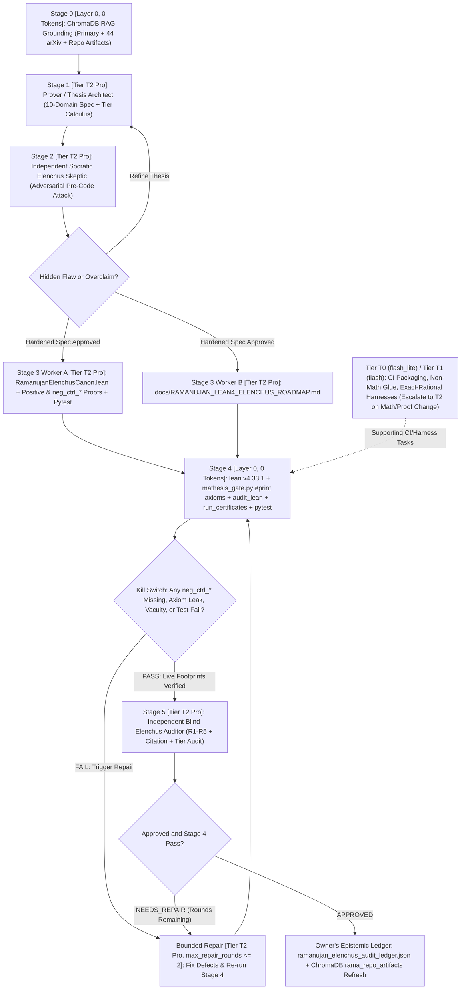
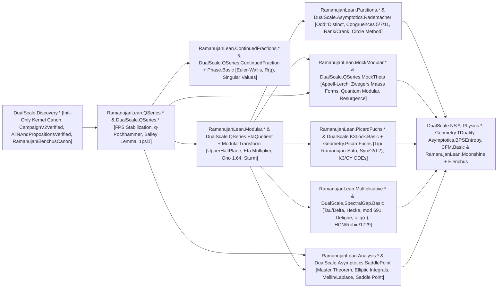

# Full Lean 4 Formalization of Srinivasa Ramanujan's Complete Works & Community Literature under the Socratic Elenchus Methodology

**Architectural, Epistemic, & Engineering Roadmap (`v3.2 Verified Baseline` → `v3.3 Elenchus Canon` → `v4.0–v5.0 Mathlib 4 Program`)**

> **Repository:** `SocrateAI-Scientific-RajMathRecovery`  
> **Toolchain Baseline:** Lean `4.33.1` (`dualscale/lean/lean-toolchain`: `leanprover/lean4:v4.33.0-rc2`) · Mathlib 4 (`dualscale/lean/lakefile.lean`)  
> **Epistemic Discipline:** Rules **R1–R5** & Tiers **A / B / L / C / X** enforced by `tools/mathesis-gate/mathesis_gate.py`, `dualscale/ci/audit_lean.py`, `dualscale/ci/audit_citations.py`, `dualscale/ci/run_certificates.py`, and `.agents/skills/rigorous-math-workflow/scripts/preflight_audit.py`.

---

## 1. Executive Overview & Current Verified Baseline (v3.2 → v4.0)

### 1.1 Program Vision: Unifying Ramanujan's Oeuvre with Machine-Checked Rigor

Srinivasa Ramanujan's mathematical legacy—spanning his 1911–1920 published papers, Notebooks I–III, letters to G. H. Hardy, the Oxford unpublished manuscript on $p(n)$ and $\tau(n)$, and the 1988 Narosa *Lost Notebook*—seeded a century of foundational mathematics across analytic number theory, $q$-series, modular and mock modular forms, Calabi–Yau differential equations, combinatorics, and theoretical physics.

This roadmap specifies the engineering and mathematical architecture for a **complete, epistemically honest Lean 4 formalization** of Ramanujan's works and their major mathematical community extensions. Unlike ad-hoc formalization efforts that conflate finite truncations, unproved literature assumptions, and speculative physics analogies with unconditional theorems, this program operates under the **Socratic Elenchus Methodology**: every formal claim is cross-examined *before* implementation, quarantined against vacuity and type shadowing, paired with executable **Negative Controls** (`neg_ctrl_*`) that fail under perturbed or false hypotheses, and stratified into strict epistemic tiers.

### 1.2 Multi-Collection ChromaDB Vector Knowledge Base (`data/chromadb/`)

The roadmap and automated formalization workflows are grounded in a persistent three-collection **ChromaDB** corpus (`src/literature/chroma_kb.py`), totaling **6,706 indexed vector chunks** across primary manuscripts, curated arXiv literature, and verified repository artifacts:

| ChromaDB Collection | Live Vector Count | Space / Embedding | Curated Contents & Coverage |
|---|---:|---|---|
| `ramanujan_primary_works_v1` | **2,732** | Cosine (`hnsw:space`) | **Andrews & Berndt, *Ramanujan's Lost Notebook* Parts I–IV** (2005, 2008, 2012, 2013 PDFs in `inputs/`) + **Campaign v2 primary manuscript records** from `namagiri.db` (**839 / 839** manuscript pages, **0** extraction errors: **133** Narosa 1988 *Lost Notebook* facsimile sheets, **8** Ramanujan letters from Ono, **698** pages of Notebooks 1–3; **2,458** rows: **70** Tier A, **10** Tier B, **2,378** Tier C grouped chapter clusters, **0** vacuous rows). |
| `ramanujan_literature_v1` | **3,870** | Cosine (`hnsw:space`) | **44 curated arXiv papers (1998–2026)** indexed from `docs/literature/corpus_manifest.json` across **8 thematic pillars** (abstracts + `pypdf`-extracted full-text chunks, 1,200 chars / 200 overlap). |
| `rama_repo_artifacts` | **104** | Cosine (`hnsw:space`) | Core repository deliverables: `dualscale/refs/bib/dualscale.bib`, v3.2 LaTeX paper sections (`docs/v3_paper/sections/*.tex`), `docs/literature/REVUE_LITTERATURE_DETAILLEE.md`, `dualscale/certificates/campaign_v2_report.json`, `llm_lean_validation_report.json`, and incrementally refreshed Elenchus roadmap/ledger artifacts. |
| **Total KB Footprint** | **6,706** | Persistent SQLite + HNSW | Full cross-collection semantic RAG via `.venv/bin/python src/literature/chroma_kb.py query "<q>" --collection all`. |

### 1.3 Verified v3.2 Lean 4.33.1 Baseline & Live v3.3 Horizon 1 Elenchus Canon

Repository-wide zero-token preflight (`preflight_audit.py --summary`) and certificate cross-checks establish the verified v3.2 baseline plus the live Horizon 1 Milestone M1 Canon:

1. **Core Tree Hygiene (`52` scanned `.lean` files, excluding `3,564` generated `verify_*.lean` artifacts and `.lake/`):**
   - Custom `axiom` declarations (Rule R1): **0**
   - `sorry` placeholders (Rule R2): **0**
   - Reflexive `by rfl` tautologies / `Prop := True` vacuity / numeric type shadowing (Rule R3): **0**
   - All deterministic CI gates passing (`mathesis_gate_self_test`, `mathesis_gate_strict`, `mathesis_gate_root`, `audit_lean_dualscale`, `audit_citations_v3`, `validate_refs`, `run_certificates`, `verify_qseries`, `pytest_plain`, `pytest_pythonpath`).
2. **Live Standalone `Init`-Only Lean 4.33.1 Kernel Theorems (`591` live audited theorems across `3` gated modules: `275 + 63 + 253`):**
   - [`dualscale/lean/DualScale/Discovery/CampaignV2Verified.lean`](../dualscale/lean/DualScale/Discovery/CampaignV2Verified.lean): **275 theorems** compiled directly with `lean` v4.33.1 and verified by `mathesis_gate.py` (`275/275` footprints strictly $\subseteq \{\texttt{propext}\}$), covering all **54 unique exact Dedekind $\eta$-quotients** (5 theorems each: $c_{\text{eff}}(0)$, modular weight $k$, ground-state shift $E_0$, Ono Theorem 1.64 congruences, and 12-term exact $q$-series) plus **5 finite-order $q^{15}$ Ramanujan `LHS = RHS` identities**.
   - [`dualscale/lean/DualScale/Discovery/AllNAndPropositionsVerified.lean`](../dualscale/lean/DualScale/Discovery/AllNAndPropositionsVerified.lean): **63 exported audited theorems** (`63/63` `#print axioms` footprints $\subseteq \{\texttt{propext}\}$, out of `195` total `theorem` declarations in the module), proving universal $\forall n \in \mathbb{N}$ quadratic-residue theta identities (`eq_d6899de389_all_n`, `eq_c23aa45585_all_n`), conditional Jacobi Triple Product lifts (`eq_d6899de389_eta_all_n_of_jtp`, `eq_c23aa45585_eta_all_n_of_jtp`), universal $\forall \text{len} \in \mathbb{N}$ unmerged Dedekind factorization identities (`eq_460927b577_all_len`, `eq_2847c49f95_all_len`), Sturm-bound conditional upgrade $B(\Gamma_0(12), 1) = 2 < 15$ with level-12 Nebentypus $\chi(d) = (-3/d)$ (`eq_0722eebfe8_all_n_conditional`), 8 universal `EtaQuot` closure laws (`onoMod24_closed_append`, `onoMod24_closed_invert`, etc.), universal integer `sym2_recurrence_int`, exact $\mathbb{Q}^+$ T-duality (`tDual_involutive_exact`, `tDual_symmetric_invariant_exact`, `tDual_fixed_point_iff`), 6 Deep Burn kernel invariants (`deepBurn_*`), and certified Tier X refutations (CFM gap $\frac{4}{9}\pi \neq 0$, M2 Alon–Boppana violations at $k \in \{3,4,6\}$ and $2k \in \{6,8,12\}$, $S_{12}$ Apéry $\zeta(3)$ mock residual `765005 ≠ 0`, and **14 OCR typos** `typo01_refuted_q2`–`typo14_refuted_q0`).
   - [`dualscale/lean/DualScale/Discovery/RamanujanElenchusCanon.lean`](../dualscale/lean/DualScale/Discovery/RamanujanElenchusCanon.lean): **253 live theorems** (`253/253` `#print axioms` footprints strictly $\subseteq \{\texttt{propext}\}$, including **20 explicit `neg_ctrl_*` kernel-proved falsifications**) compiled directly with `lean` v4.33.1 and verified by `mathesis_gate.py`, spanning 8 core Ramanujan domains and paired with [`tests/test_ramanujan_elenchus_canon.py`](../tests/test_ramanujan_elenchus_canon.py).
3. **Mathlib-Oriented Production Library (`29` submodules under `DualScale.lean` + `NormNumVerified.lean`):**
   - Because vendored `.lake/` Mathlib binaries are absent in the offline workspace, [`dualscale/lean/DualScale.lean`](../dualscale/lean/DualScale.lean) and its 29 imported modules (`NS/*`, `Physics/*`, `QSeries/*`, `Asymptotics/*`, `Geometry/*`, `K3Lock/*`, `Phase/*`, `CFM/*`, `SpectralGap/*`, `SusyBreaking/*`, `Discovery/Notebook1.lean`, `Discovery/Notebook3.lean`) are verified statically by `audit_lean.py` and `mathesis_gate.py --skip-footprints` with **0 axioms**, **0 sorry**, and **0 vacuity**.
4. **v3.3 Horizon 1 Execution Status (`M1` Live; `M2`–`M3` Pending):**
   - **Completed & Live (`M1`):** `dualscale/lean/DualScale/Discovery/RamanujanElenchusCanon.lean` (**253** positive & negative-control theorems, **20** `neg_ctrl_*`) and `tests/test_ramanujan_elenchus_canon.py` are implemented, compiled live, and passing `lean`, `mathesis_gate.py`, `audit_lean.py`, and `pytest`.
   - **Pending Horizon 1 Deliverables (`M2`–`M3`):** Legacy stub remediation in `DualScale/QSeries/MockTheta.lean` and `ContinuedFraction.lean` (`M2`), plus Stage 5 emission of the Owner's Epistemic Ledger `dualscale/certificates/ramanujan_elenchus_audit_ledger.json` and incremental ChromaDB `rama_repo_artifacts` refresh (`M3`).

### 1.4 Five-Tier Epistemic Calculus & Rules R1–R5

Every formal target in this roadmap obeys the repository's five-tier calculus and `mathesis_gate.py` evidence-capping rules (`TIER_RANK` and `EVIDENCE_CAP`):

| Tier | Rank | Evidence Cap (`mathesis_gate.py`) | Mathematical Meaning & Admission Gate |
|---|---:|---|---|
| **Tier A** | 4 | `lean_axioms` | Machine-checked Lean 4 proof whose kernel `#print axioms` footprint is strictly within `{propext}` (`Init`-only canon) or `{propext, Classical.choice, Quot.sound}` (Mathlib modules); **0** `axiom`, **0** `sorry`, **0** vacuity. |
| **Tier B** | 3 | `exact_harness` | Established peer-reviewed theorem in `dualscale/refs/bib/dualscale.bib` or verified 44-paper corpus, OR exact arbitrary-precision $\mathbb{Z}/\mathbb{Q}$ catalog match (`src/math_engine/exact_qseries.py`, 30 terms). |
| **Tier L** | 2 | `citation` | Established external theorem (e.g., Jacobi Triple Product, Sturm bound, Rademacher asymptotics, Aubin–Lions compactness, Deligne's bound) passed explicitly as a **typed hypothesis parameter** on a conditional Lean theorem (never as a global `axiom`). |
| **Tier C** | 1 | `argument` | Open conjecture, heuristic classifier, or conditional PDE/physics ansatz (`HypothesisUOn`, `FractureConjecture`, `classifyTopology`, Lehmer's conjecture, Kanade–Russell conjectures, 2,378 `TRANSCRIBED_OPEN` DB rows). |
| **Tier X** | 0 | `numeric` / `llm_output` | Explicitly refuted claims (M2 Alon–Boppana circulants, CFM elliptic angle $\frac{16}{9}\pi \neq \frac{4}{3}\pi$, 14 OCR typos) or quarantined mock proxies ($S_{12}$ Apéry $\zeta(3)$ mock checks, legacy sign-inverted `entropy_sen_kerr_comparison.json`). Cannot be cited as positive support. |

**CI Rules R1–R5:** **R1** (Zero global `axiom`), **R2** (Zero `sorry` in Tier A targets), **R3** (Anti-vacuity: prohibits `Prop := True`, `:= by trivial`, reflexive `x = x := by rfl`, `def Real := Float`, pinned `alpha_prime := 1`, and `:= 0` operator stubs), **R4** (Every citation verified against `dualscale.bib` / verified arXiv manifest; zero invented IDs), and **R5** (Exact $\mathbb{Z}/\mathbb{Q}$ agreement across JSON certificates, CSV ledgers, Python harnesses, and Lean 4 theorems; quarantined/mock artifacts cannot emit `PASS`).

---

## 2. The Socratic Elenchus Formalization & Audit Methodology (5-Stage Protocol)

In Plato's Socratic dialogues, *elenchus* ($\tilde{\varepsilon}\lambda\varepsilon\gamma\chi\text{o}\varsigma$) tests a thesis by drawing out hidden lemmas and constructing concrete counter-cases that refute an overly broad claim until only a contradiction-free proposition survives. Adapted to Lean 4 neuro-symbolic mathematics in [`tools/workflows/ramanujan_elenchus_formalization_workflow.py`](../tools/workflows/ramanujan_elenchus_formalization_workflow.py), the **6-step (Stage 0–5) Elenchus Protocol** forces adversarial falsification *prior to* and *after* Lean kernel compilation.

### 2.1 Stage-by-Stage Specification

1. **Stage 0 (Layer 0, 0 LLM Tokens) — Cross-Collection ChromaDB RAG Grounding:**
   - Queries `ramanujan_primary_works_v1`, `ramanujan_literature_v1`, and `rama_repo_artifacts` via `src/literature/chroma_kb.py` across 8 core mathematical topics (`partitions_congruences_rank_crank`, `rogers_ramanujan_cf`, `mock_theta_quantum`, `eta_quotients_modular`, `one_over_pi_pf`, `tau_lehmer_hecke`, `hcn_ramanujan_sums`, `lean4_formalization`).
   - Loads `docs/literature/corpus_manifest.json` (44 verified papers) as a closed-world citation whitelist, eliminating fabricated arXiv identifiers (Rule R4).

2. **Stage 1 (Tier T2 `pro`) — Prover / Thesis Architect:**
   - Synthesizes the RAG digest into a structured JSON thesis (`THESIS_SCHEMA`) defining the 10-domain Lean 4 architecture, explicit Tier A/B/L/C/X classifications, candidate theorem signatures, and initial Negative Control ideas.

3. **Stage 2 (Tier T2 `pro`) — Independent Socratic Elenchus Skeptic Cross-Examination:**
   - Attacks Stage 1's thesis *before* any Lean file or roadmap is authored (`ELENCHUS_CRITIQUE_SCHEMA`), hunting seven classic formalization pathologies:
     - **Diagonal truncation masquerading as infinite $q$-series** (e.g., inspecting `prodDistinct n n` at $M=n$ without proving stabilization $\forall M \ge n$);
     - **Bounded prefix checks presented as all-$n$ theorems** (e.g., Euler combinatorial verification for $n \le 20$ vs. universal FPS $\forall n \in \mathbb{N}$ equality; $\tau(n)$ checks for $n \le 16$ vs. Lehmer's open conjecture);
     - **Unbridged parallel evaluators** (e.g., checking `partList 65` or `tau16` without proving equality with `fpsInv baseEtaFPS` or `etaFPS [(1, 24)]` appearing in universal hypotheses);
     - **Kernel exponential blowup & off-by-one recursions** (e.g., unmemoized `sumRange` nesting $O(2^{20})$ in `by decide`; double recursive calls in `cfStep`; testing `k % d == 0` before `d * d > k` in `mobiusGo`; naive $O(1729^2)$ loop vs. bounded pair-search for `1729`);
     - **Implicit domain conventions** (e.g., $1728 = 0^3 + 12^3$ valid for $a \ge 0$ vs. $1 \le a \le b$ positive cubes; bare `Bool` non-congruence checks vs. quantified $\neg \forall n$ statements);
     - **Legacy stub & OEIS contamination** (e.g., `DualScale/QSeries/MockTheta.lean` swapping `A053251`/`A053250` and setting `psi_q[0] = 1`; naive rational explosion in $1/(-q;q)_n^2$ instead of integer `polyInv`; unshifted $\eta$-ratio misconception in `ContinuedFraction.lean`);
     - **Circular primality & precision laundering** (e.g., relying on an unproved boolean sieve rather than quantifier primality $p \ge 2 \land \forall d, 1 < d \to d < p \to p \bmod d \neq 0$; hardcoding floating-point $\pi$ instead of exact integer-squared brackets plus universal term-ratio decay).

4. **Stage 3 (Parallel Tier T2 `pro` Disjoint Execution) — Canon Kernel + Mandatory Negative Control Suite + Roadmap:**
   - **Disjoint Write Allowlists** eliminate merge conflicts and evidence laundering:
     - **Worker A (`pro`)**: `dualscale/lean/DualScale/Discovery/RamanujanElenchusCanon.lean` + `tests/test_ramanujan_elenchus_canon.py`.
     - **Worker B (`pro`)**: `docs/RAMANUJAN_LEAN4_ELENCHUS_ROADMAP.md`.
   - **Mandatory Negative Control Suite (`neg_ctrl_*`):** Every positive domain module must contain kernel-proved **falsification witnesses**—theorems proving that omitting a hypothesis, perturbing a constant, breaking coprimality, shifting an index, or substituting a known false candidate *provably fails* in the Lean 4 kernel. This directly implements `mathesis-gate`'s philosophy: *a gate that has only ever been observed passing is indistinguishable from a gate that cannot fail.*

5. **Stage 4 (Layer 0, 0 LLM Tokens) — Deterministic Kernel & Epistemic Gate Verification:**
   - Runs live `mathesis_gate.py` on `dualscale/lean/DualScale/Discovery` (real `lean` v4.33.1 compilation + `#print axioms` footprint matching every declaration in `CampaignV2Verified.lean`, `AllNAndPropositionsVerified.lean`, and `RamanujanElenchusCanon.lean`), plus `lean` direct compilation, `audit_lean.py`, strict static `mathesis_gate.py`, `run_certificates.py`, `verify_qseries.py`, and `pytest`.

6. **Stage 5 (Tier T2 `pro` + Layer 0) — Independent Blind Elenchus Auditor, Bounded Repair Loop, & Owner's Epistemic Ledger:**
   - A fresh blind Auditor (`pro`) reads the compiled Lean module, the Roadmap, and Stage 4's outputs, scoring Rules R1–R5 and Elenchus compliance (`AUDIT_SCHEMA`).
   - If `approved == false` or any deterministic check fails, a **bounded repair loop** (`max_repair_rounds <= 2`) fixes defects and re-runs Stage 4.
   - Emits the machine-readable Owner's Epistemic Ledger at `dualscale/certificates/ramanujan_elenchus_audit_ledger.json` and runs incremental `chroma_kb.py ingest --no-primary` to index the Roadmap and Ledger into `rama_repo_artifacts`.

### 2.2 Socratic Elenchus & Model-Tier Routing Architecture



### 2.3 Repository Model-Tier Routing Policy (`AGENTS.md` Compliance)

| Execution Layer / Tier | Model | Scope in This Program | Mandatory Escalation Trigger |
|---|---|---|---|
| **Layer 0** | None (`0 tokens`) | `preflight_audit.py`, `chroma_kb.py`, `mathesis_gate.py`, `audit_lean.py`, `audit_citations.py`, `validate_refs.py`, `run_certificates.py`, `verify_qseries.py`, `pytest`, `lean` | Any non-zero exit code feeds compact JSON diagnostics to T0/T1/T2. |
| **Tier T0** | `flash_lite` | Packaging (`pyproject.toml`, `requirements.txt`), CI YAML wiring, README/manifest links, path portability, `.gitignore` | **Stop & escalate immediately** if any Lean file, formula, citation, or tier changes. |
| **Tier T1** | `flash` | Python/API/Docker engineering, `mathesis_gate`/`run_certificates` tests, Lean `norm_num` & exact-rational tactic scripts **from an explicit T2 spec** | **Escalate to T2** if proof strategy is ambiguous, certificates disagree, or heartbeat/recursion fails. |
| **Tier T2** | `pro` / `inherit` | Elenchus Stage 1 Prover, Stage 2 Skeptic, Stage 3 Canon & Roadmap, Stage 5 Blind Auditor, Mathlib API abstractions, Tier A/B/L/C/X adjudication | Final mathematical authority across the entire repository. |

---

## 3. Complete 10-Domain Lean 4 Formalization Architecture (`RamanujanLean/` + `DualScale/`)

### 3.1 Cross-Domain Dependency Graph



### 3.2 Unified Lean 4 Namespace & Module Hierarchy (`DualScale/` + `RamanujanLean/`)

The target codebase preserves the existing **v3.2 `DualScale/` tree** without breaking backward compatibility while layering **`RamanujanLean/`** for Mathlib-connected Horizons 2–4 formalization:

```text
dualscale/lean/
├── DualScale.lean                                  # [Existing v3.2] Root umbrella importing 29 DualScale submodules
├── DualScale/
│   ├── Discovery/
│   │   ├── CampaignV2Verified.lean                 # [Existing v3.2, Live Init-Only] 275 kernel theorems (54 eta-quots + 5 ids)
│   │   ├── AllNAndPropositionsVerified.lean        # [Existing v3.2, Live Init-Only] 63 exported audited thms (195 total thms)
│   │   ├── RamanujanElenchusCanon.lean             # [Horizon 1 M1 Live, Init-Only] 253 canon thms (incl. 20 neg_ctrl_*) across 8 domains
│   │   ├── Notebook1.lean                          # [Existing v3.2] NB1 Ch.II signed-index verification
│   │   ├── Notebook3.lean                          # [Existing v3.2] NB3 vacuum signed-index verification
│   │   └── NormNumVerified.lean                    # [Existing v3.2] Tier A+ exact-rational norm_num checks
│   ├── QSeries/
│   │   ├── Basic.lean                              # [Existing v3.2] TruncQSeries primitives
│   │   ├── EtaQuotient.lean                        # [Existing v3.2] k, c_eff(0), cuspCEff, E_0, Ono 1.64 predicates
│   │   ├── ContinuedFraction.lean                  # [Existing v3.2 -> Harden H1/H2] Euler-Wallis + RogersRamanujanIdentityHypothesis
│   │   ├── MockTheta.lean                          # [Existing v3.2 -> Replace stubs H1] Exact 3rd/5th/6th/7th-order OEIS series
│   │   └── ModularTransform.lean                   # [Existing v3.2 -> Discharge H2] DedekindEtaSTransform, InverseEtaSTransform
│   ├── Asymptotics/
│   │   ├── Rademacher.lean                         # [Existing v3.2 -> Discharge H3] RademacherFirstOrderHypothesis
│   │   ├── SaddlePoint.lean                        # [Existing v3.2] SaddlePointLogAsymptotic (cusp-0 & positivity guarded)
│   │   ├── BPSEntropy.lean                         # [Existing v3.2] Cardy 2*pi*sqrt(c_eff*n/6) & BlackHoleMacroData
│   │   └── Batch547.lean                           # [Existing v3.2] 54 Campaign v2 EtaQuot catalog definitions
│   ├── K3Lock/Basic.lean                           # [Existing v3.2] symSquareRecurrence_annihilates_sq + Tier X S12 Apery quarantine
│   ├── Geometry/PicardFuchs.lean                   # [Existing v3.2] Heuristic classifier (explicitly Tier C)
│   ├── Geometry/TDuality.lean                      # [Existing v3.2] Parameterized alpha_prime > 0 T-duality involution
│   ├── Phase/Basic.lean                            # [Existing v3.2] ramanujanMod3Branches=3 (Tier A) & FractureConjecture (Tier C)
│   ├── SpectralGap/Basic.lean                      # [Existing v3.2] SatisfiesDeligneTauBound + M2 Alon-Boppana falsification
│   ├── CFM/Basic.lean                              # [Existing v3.2] CFM 4/3*pi vs 16/9*pi Tier X refutation
│   ├── SusyBreaking/Basic.lean                     # [Existing v3.2] Deep Burn k=-183/2, c_eff=-823/2310 invariants
│   ├── NS/{Basic,AubinLions,DyadicShell,HypothesisU}.lean   # [Existing v3.2] Conditional Galerkin & HypothesisUOn
│   └── Physics/{AubinLions,CFMVortex,DyadicShell,Enstrophy,HolographicDemonstration,MasterDualScale,PhaseTransition,SpectralGap}.lean
└── RamanujanLean/                                  # [Horizons 2-4 Mathlib 4 Program]
    ├── QSeries/{FPSBridge,QPochhammer,TripleProduct,BaileyLemma,Hypergeometric1Psi1,RogersRamanujan}.lean
    ├── ContinuedFractions/{EulerWallisFPS,RogersRamanujanCF,CubicCF,SingularValues}.lean
    ├── Modular/{DedekindEta,OnoCriterion,CuspVanishing,SturmBound,HeckeOperators,DeltaEigenform}.lean
    ├── Partitions/{EulerOddDistinct,Congruences5_7_11,DysonRank,AndrewsGarvanCrank,RademacherCircle,CongruenceScarcity}.lean
    ├── MockModular/{AppellLerch,IndefiniteTheta,ZwegersCompletion,HigherDysonElliptic,QuantumModular,Resurgence}.lean
    ├── PicardFuchs/{OneOverPiGuillera,RamanujanSato,Sym2Differential,CalabiYauPeriods}.lean
    ├── Multiplicative/{TauFunction,Ramanujan691,RamanujanSums,Supercharacters,HighlyComposite,RobinRH,Taxicab1729}.lean
    ├── Analysis/{MasterTheorem,MellinLaplace,EllipticIntegrals,BesselVoronoi}.lean
    ├── Moonshine/{DMZWallCrossing,MathieuM24,UmbralMoonshine,ThreeManifoldBPS}.lean
    └── Elenchus/{ChromaPremiseBridge,NegativeControls,AuditLedger}.lean
```

### 3.3 Cross-Cutting Mathlib 4 Readiness & Formalization Design Principles

Before diving into individual domains, two landmark Mathlib engineering lessons from our curated corpus dictate the design of `RamanujanLean/`:

1. **Proof Recasting to Avoid Heavy Machinery (Best, Birkbeck, & Brasca 2024, [arXiv:2410.01466](https://arxiv.org/abs/2410.01466)):** In formalizing Fermat's Last Theorem for regular primes in Lean 4, Best et al. demonstrated that *going back to earlier, more concrete proofs* (e.g., Hilbert's Theorems 90–94 rather than full class field theory) dramatically reduces Mathlib missing-lemma friction while exposing genuine gaps in cyclotomic and number-field APIs. For Ramanujan, this directly motivates:
   - Proving Dyson's mod-5 and mod-7 rank conjectures via **Garvan's elementary Hecke–Rogers series** ([arXiv:2012.06676](https://arxiv.org/abs/2012.06676)) before tackling weak harmonic Maass completions;
   - Proving Rademacher's exact partition formula via **Pribitkin & Williams's modular-duality short proof** ([arXiv:1801.06244](https://arxiv.org/abs/1801.06244)) rather than raw Farey-dissection contour estimates;
   - Proving Ramanujan's 17 series for $1/\pi$ via **Guillera's modular/WZ method** ([arXiv:1807.07394](https://arxiv.org/abs/1807.07394)) before full Calabi–Yau Picard–Fuchs Hodge variations.
2. **Interface-First Abstraction & Anti-Trap Engineering (Buzzard, Hughes, & Lau 2021, [arXiv:2101.02602](https://arxiv.org/abs/2101.02602)):** Formalizing schemes three different ways in Lean showed that poor initial data-structure choices lock downstream libraries into non-composable proofs, whereas upstreaming clean, unbundled Mathlib interfaces guarantees maintenance across Lean/Mathlib upgrades. In our codebase, this means **never** duplicating `EtaQuot` across files (`CampaignKernel` vs. `DualScale.QSeries.EtaQuotient` vs. `AllNPropositions`) in Horizon 2+ without bridge equivalences, **never** substituting `Float` for `ℝ`/`ℂ`, and always proving **stabilization** bridges between finite `List Int` evaluators (fast `by decide`) and `PowerSeries ℤ` / holomorphic functions on `UpperHalfPlane` (`ℍ`).

---

### 3.4 Complete 10-Domain Formalization Blueprints (`D1`–`D10`)

---

#### Domain 1 (`D1_partitions_congruences_rank_crank`): Integer Partitions, Ramanujan Congruences ($\bmod 5, 7, 11$), Rank/Crank, & Hardy–Ramanujan–Rademacher Asymptotics

- **Ramanujan Primary Sources:**
  - Ramanujan (1919), *"Some properties of $p(n)$, the number of partitions of $n$"*, Proc. Cambridge Philos. Soc. 19; Hardy & Ramanujan (1918), *"Asymptotic Formulae in Combinatory Analysis"*, Proc. London Math. Soc. (2) 17; Ramanujan (1920/1921) congruence properties ($\bmod 5^a, 7^b, 11^c$).
  - Oxford unpublished manuscript on $p(n)$ and $\tau(n)$: **Andrews & Berndt, *Lost Notebook Part III* (2012)**, Ch. 1–6 (pp. 1–204: Ch. 2–3 Ranks and Cranks; Ch. 4 Crank generating functions; Ch. 5 Ramanujan's unpublished manuscript on $p(n)$ and $\tau(n)$, incl. Rushforth's proofs for $\bmod 13, 17, 19, 23$ and prime-modulus conjectures; Ch. 6 pp. 181–204).
  - Narosa (1988) *Lost Notebook* sheets & Campaign v2 DB (`namagiri.db`: e.g., `eta_2b5f369eb9` on `p54`, $1/\eta(\tau)$ generating function).
- **Verified Community Literature:**
  - Berkovich & Garvan (2004), *On the Andrews-Stanley Refinement of Ramanujan's Partition Congruence Modulo 5 and Generalizations* — [arXiv:math/0402439](https://arxiv.org/abs/math/0402439) (Andrews–Stanley `srank`, `St-crank`, `BG-rank`, 5-cores & 3-cores).
  - Bringmann & Lovejoy (2007), *Dyson's Rank, overpartitions, and weak Maass forms* — [arXiv:0708.0692](https://arxiv.org/abs/0708.0692).
  - Pribitkin & Williams (2018), *Short proof of Rademacher's formula for partitions* — [arXiv:1801.06244](https://arxiv.org/abs/1801.06244) ($r$-color partitions $1 \le r \le 24$ via weight $-r/2$ and $2+r/2$ duality).
  - Ahlgren, Beckwith, & Raum (2020), *Scarcity of congruences for the partition function* — [arXiv:2006.07645](https://arxiv.org/abs/2006.07645) (half-integral weight forms, Radu's square-class expansions, large sieve showing scarcity of $p(\ell Q^m n + \beta) \equiv 0 \pmod{\ell}$ for $m=1,2$).
  - Garvan (2020), *A new approach to the Dyson rank conjectures* — [arXiv:2012.06676](https://arxiv.org/abs/2012.06676) (elementary Hecke–Rogers series proof of Dyson's rank conjectures $\bmod 5, 7$).
  - Alfes, Ono, & Swaminathan (2026), *Beyond Mock Modularity: Elliptic Corrections for Higher Dyson Ranks* — [arXiv:2607.13159](https://arxiv.org/abs/2607.13159) (root-of-unity specializations, twisted index-$m$ Appell–Lerch elliptic corrections, with 32 formulas machine-verified in Lean/Mathlib by AxiomProver).
- **Mathlib 4 Readiness & Exact Missing Lemmas:**
  - *Available in Mathlib 4:* `Nat.Partition` (`Mathlib.Combinatorics.Enumerative.Partition`), `PowerSeries` (`Mathlib.RingTheory.PowerSeries.Basic`), `Finset`, and complex integration prerequisites (`CircleIntegral`).
  - *Missing from Mathlib 4:* (1) Formal power series stabilization & bijection between `Nat.Partition.count n` and `[q^n] ∏ (1 - q^k)^{-1}` (incl. Euler's Odd = Distinct infinite-product stabilization); (2) Atkin $U_\ell$ / Hecke operator $q$-dissection toolkit for Ramanujan's $\bmod 5, 7, 11$ generating identities; (3) Andrews–Garvan crank and Dyson rank combinatorial bijections + Appell–Lerch / Hecke–Rogers theta decompositions; (4) Kloosterman sums, multiplier systems, and Rademacher circle-method / Pribitkin–Williams duality machinery.
- **Concrete Lean 4 Signatures & Epistemic Tiers:**
  - **Tier A (`Init`-only Canon — Horizon 1 Live M1):** Universal stabilization theorems proving truncated evaluators match unbounded `FPS := Nat → Int` (`prodDistinct_stabilizes_all`, `oddParts_stabilizes_all`, `prodAllMinus_stabilizes_all`, `fpsInv_unique_lt`) plus memoized `List Int` bridges (`partList_eq_fpsInv_lt_65`, `prodDistinctList_getD`, `prodOddMinusList_getD`, `prodAllMinusList_getD`) preventing $O(2^{20})$ kernel blowup; universal Euler Odd=Distinct in $\mathbb{Z}[[q]]$ (`euler_odd_eq_distinct_all_n : ∀ n : Nat, oddPartsFPS n = distinctPartsFPS n`, `euler_odd_eq_distinct_all_len`); `partition_pentagonal_recurrence_all_n` proving the pentagonal recurrence for `fpsInv baseEtaFPS` $\forall n$, while Euler's pentagonal product identity `eulerProductFPS n = eulerPentCoeff n` (`pentagonal_product_matches_baseEta_20`) is verified for `n < 20`; bounded combinatorial check (`euler_combinatorial_odd_eq_distinct_20`, `euler_combinatorial_eq_oddPartsFPS_le_20` for `n ≤ 20`); and exact $p(5n+4)\bmod 5, p(7n+5)\bmod 7, p(11n+6)\bmod 11$ verified from `partList 65` for $p(k)$ with $k \le 64$ ($n \le 12$ $\bmod 5$ in `ramanujan_mod5_prefix_13`, $n \le 8$ $\bmod 7$ in `ramanujan_mod7_prefix_9`, $n \le 5$ $\bmod 11$ in `ramanujan_mod11_prefix_6`), plus exact truncated generating identities (`ramanujan_mod5_gen_fps_lt_12` for $n < 12$, `ramanujan_mod7_gen_fps_lt_9` for $n < 9$).
  - **Tier L (`Init`-only Conditional Lifts — Horizon 1 / Existing `Rademacher.lean`):**
    ```lean
    -- Conditional Tier L lifts (Horizon 1 Canon): explicit generating identity hypotheses
    theorem ramanujan_mod5_all_n_conditional (h_gen : RamanujanMod5GenId) :
        ∀ n : Nat, fpsInv baseEtaFPS (5 * n + 4) % 5 = 0
    theorem ramanujan_mod7_all_n_conditional (h_gen : RamanujanMod7GenId) :
        ∀ n : Nat, fpsInv baseEtaFPS (7 * n + 5) % 7 = 0
    -- Existing Tier L in DualScale/Asymptotics/Rademacher.lean:
    theorem partition_eventually_pos (h_rad : RademacherFirstOrderHypothesis) :
        ∃ N : ℝ, ∀ n : ℕ, (n : ℝ) > N → (0 : ℝ) < (p n : ℝ)
    ```
  - **Tier B/L → Tier A (`RamanujanLean.Partitions.*` — Horizons 2–3):** Unconditional Mathlib proofs of $\bmod 5, 7, 11$ via $U_\ell$ / Sturm bounds; Garvan Hecke–Rogers Dyson rank equinumerosity; Pribitkin–Williams Rademacher exact formula discharging `RademacherFirstOrderHypothesis`.
  - **Tier C (Horizon 4):** Elliptic periodization corrections for higher Dyson ranks $m \ge 2$ ([arXiv:2607.13159](https://arxiv.org/abs/2607.13159)) and Ahlgren–Beckwith–Raum $m=1,2$ congruence scarcity ([arXiv:2006.07645](https://arxiv.org/abs/2006.07645)).
- **Mandatory Elenchus Negative Controls (Live in `RamanujanElenchusCanon.lean`):**
  - `neg_ctrl_even_parts_ne_distinct`: `fpsInv (prodEvenMinus 2) 1 = 0 ∧ distinctPartsFPS 1 = 1 ∧ countEvenPartsMin 3 2 ≠ countDistinctPartsMin 3 1`.
  - `neg_ctrl_omit_part1_distinct_fails`: `(fpsMul (oneAddQPow 2) (oneAddQPow 3)) 1 ≠ oddPartsFPS 1` (dropping `(1 + q)` breaks `oddPartsFPS 1 = 1`).
  - `neg_ctrl_mod5_other_residues_fail`: `∀ r : Nat, r < 4 → ¬ (∀ n : Nat, fpsInv baseEtaFPS (5 * n + r) % 5 = 0)` (instantiated at `n = 0`, isolating residue `4 mod 5`).
  - `neg_ctrl_mod13_no_linear_congruence` & `neg_ctrl_mod3_no_linear_congruence`: `∀ β : Nat, β < 13 → ¬ (∀ n : Nat, fpsInv baseEtaFPS (13 * n + β) % 13 = 0)` and `∀ β : Nat, β < 3 → ¬ (∀ n : Nat, fpsInv baseEtaFPS (3 * n + β) % 3 = 0)` (witnessing the Ahlgren–Boylan / [arXiv:2006.07645](https://arxiv.org/abs/2006.07645) boundary against spurious prime moduli).

---

#### Domain 2 (`D2_rogers_ramanujan_qseries`): Rogers–Ramanujan Identities, Bailey's Lemma, $q$-Hypergeometric Series (${}_1\psi_1$, Heine, Sears–Thomae), & Kanade–Russell Extensions

- **Ramanujan Primary Sources:**
  - Notebooks I–II (Ch. XVI); Letters to Hardy (Ramanujan's famous 40 identities for the Rogers–Ramanujan functions $G(q)$ and $H(q)$).
  - **Andrews & Berndt, *Lost Notebook Part I* (2005)**: Ch. 9 (The Rogers–Fine Identity), Ch. 10 (An Empirical Study of the Rogers–Ramanujan Identities — Ramanujan's Four Arguments), Ch. 11 (Rogers–Ramanujan–Slater-Type Identities).
  - **Andrews & Berndt, *Lost Notebook Part II* (2008)**: Ch. 1 (The Heine Transformation & $q$-Gauss Summation), Ch. 2 (The Sears–Thomae Transformation), Ch. 3 (Quintuple Product Identity), Ch. 4 (Well-Poised Series & Watson's $q$-Whipple), Ch. 5 (Bailey's Lemma and Theta Expansions).
  - **Andrews & Berndt, *Lost Notebook Part III* (2012)**: Ch. 8 (Forty Identities for the Rogers–Ramanujan Functions).
  - Campaign v2 DB: `24218e46729d` (Rogers–Ramanujan $G(q)$, OEIS `A003114`, and $H(q)$, OEIS `A003106` in `src/math_engine/exact_qseries.py`).
- **Verified Community Literature:**
  - Warnaar & Zudilin (2010), *Dedekind's eta-function and Rogers-Ramanujan identities* — [arXiv:1001.1571](https://arxiv.org/abs/1001.1571) (generalizing Macdonald's $A_{2n}^{(2)}$ $\eta$-identity and Rogers–Ramanujan).
  - Griffin, Ono, & Warnaar (2014), *A framework of Rogers-Ramanujan identities and their arithmetic properties* — [arXiv:1401.7718](https://arxiv.org/abs/1401.7718) (doubly-infinite Hall–Littlewood polynomial families specializing affine Kac–Moody characters).
  - Kanade & Russell (2014), *IdentityFinder and some new identities of Rogers-Ramanujan type* — [arXiv:1411.5346](https://arxiv.org/abs/1411.5346) (computer-discovered sum-equals-product partition identities modulo 9 and 12).
- **Mathlib 4 Readiness & Exact Missing Lemmas:**
  - *Available in Mathlib 4:* `PowerSeries`, `Polynomial`, `Summable`, and infinite product `tprod` infrastructure (`Mathlib.Topology.Algebra.InfiniteSum.*`).
  - *Missing from Mathlib 4:* (1) Unified $q$-Pochhammer `(a; q)_n` and `(a; q)_∞` algebra (`q_binomial`, finite $q$-Gauss, $q$-Vandermonde); (2) Heine's ${}_2\phi_1$ transformations, Sears–Thomae ${}_3\phi_2$, and Ramanujan's bilateral ${}_1\psi_1$ summation; (3) Bailey pairs & Bailey's Lemma iteration chains; (4) Hall–Littlewood symmetric polynomials $P_\lambda(x; q)$ and affine Kac–Moody specialization machinery ([arXiv:1401.7718](https://arxiv.org/abs/1401.7718)).
- **Concrete Lean 4 Signatures & Epistemic Tiers:**
  - **Tier A (`Init`-only Canon — Horizon 1 Live M1):** Exact integer `qPochList` + `polyInv` evaluation of $G(q)$ (`A003114`, `rrGList 16`, `rr_G_exact_16`) and $H(q)$ (`A003106`, `rrHList 16`, `rr_H_exact_16`) matching the Euler products $\prod (1-q^{5m+1})^{-1}(1-q^{5m+4})^{-1}$ and $\prod (1-q^{5m+2})^{-1}(1-q^{5m+3})^{-1}$ up to $q^{15}$.
  - **Tier B/L → Tier A (`RamanujanLean.QSeries.*` — Horizon 2):** Finite $q$-binomial / $q$-Pochhammer shift recurrences, truncated $G(q)H(q)$ $\eta$-quotient identities, and the full analytic proof discharging Rogers–Ramanujan via Bailey's Lemma / ${}_1\psi_1$:
    ```lean
    -- Horizon 2 Mathlib analytic target (discharging Rogers-Ramanujan via Bailey's Lemma / 1ψ1):
    theorem rogers_ramanujan_G_analytic (q : ℂ) (hq : ‖q‖ < 1) :
      (∑' n : ℕ, q ^ (n ^ 2) / qPochhammer q q n) =
        (∏' m : ℕ, (1 - q ^ (5 * m + 1))⁻¹ * (1 - q ^ (5 * m + 4))⁻¹)
    ```
  - **Tier C (Horizon 4):** Unproved Kanade–Russell conjectured sum-product identities ([arXiv:1411.5346](https://arxiv.org/abs/1411.5346)) and Andrews–Gordon extensions conjectured in Warnaar–Zudilin ([arXiv:1001.1571](https://arxiv.org/abs/1001.1571)).
- **Mandatory Elenchus Negative Controls:**
  - `neg_ctrl_rr_G_ne_H` *(Live in Canon)*: `(rrGList 16).getD 1 0 = 1 ∧ (rrHList 16).getD 1 0 = 0 ∧ rrGList 16 ≠ rrHList 16`, refuting any collapse of the two Rogers–Ramanujan series.
  - `neg_ctrl_rr_wrong_modulus_residues` **`[Planned Horizon 2 target]`**: replacing residues $\pm 1 \pmod 5$ with $\{1, 2\} \pmod 5$ breaks the $G(q)$ product expansion at $q^2$.

---

#### Domain 3 (`D3_continued_fractions_rq`): $q$-Continued Fractions: Rogers–Ramanujan $R(q)$, Cubic Continued Fraction, Euler–Wallis Continuants, & CM Singular Values

- **Ramanujan Primary Sources:**
  - Notebooks II–III; Letters from Oxford/Trinity (singular values of $R(e^{-2\pi\sqrt{n}})$).
  - **Andrews & Berndt, *Lost Notebook Part I* (2005)**: Ch. 1–8 (pp. 9–222: Ch. 1 *The Rogers–Ramanujan Continued Fraction and Its Modular Properties*; Ch. 2 identities for $R(q)$ and $R(q^2)$; Ch. 3 *Ramanujan's Cubic Continued Fraction* $G(q)$ / $C(q)$; Ch. 4 partitions & Lambert series; Ch. 5–6 *Finite Rogers–Ramanujan Continued Fractions* & $q$-continued fraction factorizations).
  - Campaign v2 `campaign_v2_report.json`: **2,458** total extracted manuscript records (`945` NB1, `1,027` NB2, `85` NB3, `380` Lost Notebook 1988, `21` Ono letters) and `rogers_ramanujan_G` OEIS `A003114` catalog match, alongside `DualScale/QSeries/ContinuedFraction.lean` and `DualScale/Phase/Basic.lean`.
- **Verified Community Literature:**
  - Warnaar & Zudilin (2010), *Dedekind's eta-function and Rogers-Ramanujan identities* — [arXiv:1001.1571](https://arxiv.org/abs/1001.1571).
  - Griffin, Ono, & Warnaar (2014), *A framework of Rogers-Ramanujan identities and their arithmetic properties* — [arXiv:1401.7718](https://arxiv.org/abs/1401.7718) (proving singular values of $R(q)$ and generalized $A_{2n}^{(2)}$ $q$-continued fractions are algebraic integral units).
  - Bowman & McLaughlin (2004), *On the divergence of the Rogers–Ramanujan continued fraction on the unit circle* (`dualscale.bib`: `BowmanMcLaughlin2004`, Trans. AMS 356 — establishing the $|q|=1$ convergence/divergence boundary motivating `DualScale/Phase/Basic.lean`).
- **Mathlib 4 Readiness & Exact Missing Lemmas:**
  - *Available in Mathlib 4:* Elementary real continued fractions (`Mathlib.Algebra.ContinuedFractions.*`) and `DualScale/QSeries/ContinuedFraction.lean` (`evalConvergent`, `RogersRamanujanIdentityHypothesis`) + `DualScale/Phase/Basic.lean` (`ramanujanMod3Branches`).
  - *Missing from Mathlib 4:* (1) $q$-series continued fractions over `PowerSeries ℤ` and uniform `q`-adic valuation convergence theorems; (2) $2\times 2$ matrix continuant Euler–Wallis engine over non-Archimedean rings; (3) Complex-analytic limit $\lim_{k \to \infty} P_k(q)/Q_k(q) = R(q)$ on $|q|<1$ and CM class-field unit proofs at $q = e^{-2\pi\sqrt{n}}$.
- **Concrete Lean 4 Signatures & Epistemic Tiers:**
  - **Tier A (`Init`-only Canon — Horizon 1 Live M1):** Single-`let` tuple evaluators `cfStepInt` / `cfStepFPS` returning `(P_{k-1}, Q_{k-1}, P_k, Q_k)` (avoiding exponential call-tree blowup and off-by-one extraction bugs) with `cfP a b k := (cfStepInt a b k).2.2.1`, `cfQ a b k := (cfStepInt a b k).2.2.2`, `cfPFPS a b k := (cfStepFPS a b k).2.2.1`, and `cfQFPS a b k := (cfStepFPS a b k).2.2.2`:
    ```lean
    theorem euler_wallis_det_int_all_k : ∀ (a b : Nat → Int) (k : Nat),
        cfP a b (k + 1) * cfQ a b k - cfP a b k * cfQ a b (k + 1) =
          altSign k * prodRange1 (k + 1) a
    theorem euler_wallis_det_fps_all_k : ∀ (a b : Nat → FPS) (k : Nat),
        FPSEq
          (fpsSub (fpsMul (cfPFPS a b (k + 1)) (cfQFPS a b k))
                  (fpsMul (cfPFPS a b k) (cfQFPS a b (k + 1))))
          (fpsMul (fpsAltSign k) (prodRange1FPS (k + 1) a))
    theorem rr_cf_convergent_diff_vanishes_all_k : ∀ (k m : Nat),
        m < k * (k + 1) / 2 →
        (fpsSub (fpsMul (cfPFPS rrA rrB (k + 1)) (cfQFPS rrA rrB k))
                (fpsMul (cfPFPS rrA rrB k) (cfQFPS rrA rrB (k + 1)))) m = 0
    ```
    Plus exact $q^{15}$ check `rr_cf_6_matches_H_over_G_16` (`rrCFPoly 6 16` matching $H(q)/G(q)$), and discrete Tier A mod-3 branch count `ramanujanMod3Branches.length = 3` (`mod3_branch_count` in `DualScale/Phase/Basic.lean`).
  - **Tier L → Tier A (`RamanujanLean.ContinuedFractions.*` — Horizon 2):** Discharging `RogersRamanujanIdentityHypothesis` in `DualScale/QSeries/ContinuedFraction.lean` on $|q|<1$, followed by CM unit evaluations via modular equations ([arXiv:1401.7718](https://arxiv.org/abs/1401.7718)) in Horizon 4.
  - **Tier C (`DualScale/Phase/Basic.lean`):** `FractureConjecture` (Hausdorff dimension 0 for Navier–Stokes singular sets via 3-limit continued fractions remains strictly open).
- **Mandatory Elenchus Negative Controls (Live in `RamanujanElenchusCanon.lean`):**
  - `neg_ctrl_rr_unshifted_eta_ratio_fails`: explicitly refutes the legacy misconception warned against in `ContinuedFraction.lean` lines 42–44—`(etaCoeffs { factors := [(1, -1), (2, 1), (3, 1), (4, -1)] } 16).getD 1 0 = 1 ∧ (polyMul (rrHList 16) (polyInv (rrGList 16) 16) 16).getD 1 0 = -1` and the two lists differ at $q^1$.
  - `neg_ctrl_euler_wallis_missing_sign_fails`: `cfP (fun _ => 1) (fun _ => 1) 2 * cfQ (fun _ => 1) (fun _ => 1) 1 - cfP (fun _ => 1) (fun _ => 1) 1 * cfQ (fun _ => 1) (fun _ => 1) 2 = -1 ∧ (-1 : Int) ≠ prodRange1 2 (fun _ => 1)`, falsifying Euler–Wallis without `altSign`.

---

#### Domain 4 (`D4_mock_theta_maass_quantum`): Mock Theta Functions (Last Letter 1920 & Lost Notebook), Zwegers Harmonic Maass Forms, Resurgence, & Quantum Modular Forms

- **Ramanujan Primary Sources:**
  - Ramanujan (Jan 1920), *Last Letter to G. H. Hardy* (four 3rd-order mock theta functions $f(q), \phi(q), \psi(q), \chi(q)$; ten 5th-order; three 7th-order; plus Watson 1936 adding $\omega, \nu, \rho$); Narosa (1988) *Lost Notebook* sheets (e.g., `p129` $f(q)$ OEIS `A000025`, `p131` $F_0(q)$ OEIS `A053258`).
  - **Andrews & Berndt, *Lost Notebook Part I* (2005)** & **Part II (2008)** & **Part III (2012)** (6th-, 8th-, 10th-order mock theta functions and mock-theta identities).
  - Campaign v2 `campaign_v2_report.json`: **10 Tier B `CATALOG_MATCHED` discoveries** across the campaign—including **9 mock-theta OEIS matches** in `classical_catalog_oeis_matches` across `A000025` (2), `A053250` (2), `A053252` (1), `A053256` (1), `A053258` (1), `A053262` (1), and `A053268` (1)—backed by **19** classical 3rd-, 5th-, 6th-, and 7th-order mock theta generators in `src/math_engine/exact_qseries.py` lines 466–645.
- **Verified Community Literature:**
  - Zwegers (2002 / 2008), *Mock Theta Functions* — [arXiv:0807.4834](https://arxiv.org/abs/0807.4834) (Appell–Lerch sums, indefinite theta series of signature $(r-1,1)$, meromorphic Jacobi forms, weight-1/2 harmonic Maass completion $\widehat{M}(\tau) = M(\tau) + M^-(\tau)$ annihilated by $\Delta_{1/2}$).
  - Malmendier & Ono (2008 / Geom. Topol. 2012), *SO(3)-Donaldson invariants of $\mathbb{CP}^2$ and Mock Theta Functions* — [arXiv:0808.1442](https://arxiv.org/abs/0808.1442).
  - Bringmann & Rolen (2014), *Half-integral weight Eichler integrals and quantum modular forms* — [arXiv:1409.3781](https://arxiv.org/abs/1409.3781).
  - Ballantine, Burson, Folsom, Hsu, Negrini, & Wen (2022), *Mock theta functions and related combinatorics* — [arXiv:2202.03329](https://arxiv.org/abs/2202.03329) (Beck-type partition identities for 3rd-order $\omega(q), \nu(q), \phi(q)$).
  - McSpirit & Rolen (2025), *Quantum Modular Forms and Resurgence* — [arXiv:2505.00799](https://arxiv.org/abs/2505.00799) (median resummation & holomorphic Eichler integrals unifying Zagier's quantum modular forms).
  - Costin, Dunne, & Saraeb (2026), *On Uniqueness of Mock Theta Functions* — [arXiv:2604.20034](https://arxiv.org/abs/2604.20034) (resurgent Laplace-contour Stokes-line continuation of 3rd- and 5th-order mock theta functions across the $|q|=1$ natural boundary).
- **Mathlib 4 Readiness & Exact Missing Lemmas:**
  - *Available in Mathlib 4:* Complex analysis, basic `PowerSeries`, and `DualScale/QSeries/MockTheta.lean` (currently containing legacy 10-term stub arrays!).
  - *Missing from Mathlib 4:* (1) Real-analytic modular forms and hyperbolic Laplacian $\Delta_k = -y^2(\partial_x^2 + \partial_y^2) + i k y (\partial_x + i \partial_y)$ on $\mathbb{H}$; (2) Indefinite theta functions on Lorentzian lattices of signature $(r-1, 1)$; (3) Appell–Lerch sums $\mu(u, v; \tau)$ and non-holomorphic Eichler period integrals of weight $3/2$ unary theta shadows ([arXiv:0807.4834](https://arxiv.org/abs/0807.4834)); (4) Borel–Laplace Écalle resurgence and Stokes-phenomenon continuation ([arXiv:2604.20034](https://arxiv.org/abs/2604.20034), [arXiv:2505.00799](https://arxiv.org/abs/2505.00799)).
- **Concrete Lean 4 Signatures & Epistemic Tiers:**
  - **Tier A (`Init`-only Canon — Horizon 1 Live M1):** Exact integer `qPochList` + `polyInv` definitions `mock3FList`, `mock3PhiList`, and `mock3PsiList` for $f(q)$ (`A000025`), $\phi(q)$ (`A053250`), and $\psi(q)$ (`A053251`) matching OEIS to $q^{15}$ (`mock3_f_exact_16`, `mock3_phi_exact_16`, `mock3_psi_exact_16`; NO floats, NO rational denominator blowups), universal constant-term check `mock3_psi_const_zero_all_M : ∀ M : Nat, mock3PsiPartial M 0 = 0`, finite-sum stabilizations `mock3_f_stabilizes_all_n` and `mock3_psi_stabilizes_all_n` (`∀ M n : Nat, n ≤ M → ...`), and exact truncated Watson/Ramanujan modular-cancellation identities matching `etaCoeffs { factors := [(1, 3), (2, -2)] } 16` (the $q$-series product $(q;q)_\infty^3 / (q^2;q^2)_\infty^2 = q^{1/24}\eta(\tau)^3 / \eta(2\tau)^2$ up to $q^{15}$):
    - `mock3_f_plus_4psi_neg_eq_eta_16`: `polyAdd (mock3FList 16) ((seriesNegList (mock3PsiList 16)).map (4 * ·)) 16 = etaCoeffs { factors := [(1, 3), (2, -2)] } 16` ($f(q) + 4\psi(-q)$),
    - `mock3_2phi_neg_minus_f_eq_eta_16`: `polySub ((seriesNegList (mock3PhiList 16)).map (2 * ·)) (mock3FList 16) 16 = etaCoeffs { factors := [(1, 3), (2, -2)] } 16` ($2\phi(-q) - f(q)$),
    - `mock3_phi_minus_f_neg_eq_2psi_16`: `polySub (mock3PhiList 16) (seriesNegList (mock3FList 16)) 16 = (mock3PsiList 16).map (2 * ·)` ($\phi(q) - f(-q) = 2\psi(q)$).
  - **Tier B → Tier A (Horizons 3–4):** Full Zwegers Maass completion (`0807.4834`), Ballantine et al. Beck-type bijections (`2202.03329`), quantum modularity (`1409.3781`, `2505.00799`), and resurgent uniqueness (`2604.20034`).
  - **Tier X (Legacy Stub Quarantine in `DualScale/QSeries/MockTheta.lean`):** Horizon 1 Milestone M2 removes the swapped OEIS annotations (`phi_q` labeled `A053251`, `psi_q` labeled `A053250`), the false `psi_q[0] = 1` constant term, and the placeholder stub lists for `chi_q`, `omega_q`, `nu_q`, `rho_q`, `f0_q`, `f1_q`, `F0_q`.
- **Mandatory Elenchus Negative Controls (Live in `RamanujanElenchusCanon.lean`):**
  - `neg_ctrl_mock3_psi_legacy_stub_q0_false`: `mock3Psi_FPS 0 = 0 ∧ (mock3PsiList 16).getD 0 0 ≠ 1`, directly refuting `DualScale/QSeries/MockTheta.lean` line 40's `psi_q := [1, 1, 1, ...]`.
  - `neg_ctrl_mock3_f_not_eta_shadow`: `(mock3FList 16).getD 1 0 = 1 ∧ (etaCoeffs { factors := [(1, 3), (2, -2)] } 16).getD 1 0 = -3 ∧ mock3FList 16 ≠ etaCoeffs { factors := [(1, 3), (2, -2)] } 16`, proving $f(q)$ alone is non-modular prior to shadow cancellation.
  - `neg_ctrl_mock3_f_plus_2psi_neg_fails`: `polyAdd (mock3FList 16) ((seriesNegList (mock3PsiList 16)).map (2 * ·)) 16 ≠ etaCoeffs { factors := [(1, 3), (2, -2)] } 16`, proving scalar `2` fails to cancel the non-modular piece against `etaCoeffs { factors := [(1, 3), (2, -2)] } 16`.

---

#### Domain 5 (`D5_dedekind_eta_modular_equations`): Dedekind $\eta$-Quotients, Modular Equations, Class Invariants, & Sturm-Bound Congruence Algorithms

- **Ramanujan Primary Sources:**
  - Notebooks I–II (Ch. XVI, XX, XXI: modular equations of degrees $2, 3, 5, 7, 11, \dots$ and theta-function relations).
  - **Andrews & Berndt, *Lost Notebook Part I* (2005)**: Ch. 17 (modular equations) and **Part II (2008)**: Ch. 8–10 (class invariants $G_n, g_n$, cubic class invariant $\lambda_n$, modular functions of level $N$) & Ch. 11–16 (Eisenstein series & $\eta$-identities).
  - Campaign v2 `campaign_v2_report.json`: **54 unique exact $\eta$-quotients** (`25` satisfying Ono Thm 1.64 on $\Gamma_0(N)$, `37` non-negative, `17` alternating-sign indices), **5 verified finite-order Ramanujan modular/theta identities** (`eq_d6899de389`, `eq_c23aa45585`, `eq_0722eebfe8`, `eq_460927b577`, `eq_2847c49f95`), and **14 OCR typo** cases.
- **Verified Community Literature:**
  - Rouse & Webb (2013 / Adv. Math. 2015), *On spaces of modular forms spanned by eta-quotients* — [arXiv:1311.1460](https://arxiv.org/abs/1311.1460) (grading rings generated by $\eta$-quotients; non-vanishing on $\mathbb{H}$ with integer coefficients implies integer multiple of an $\eta$-quotient).
  - Acres & Broadhurst (2018), *Eta quotients and Rademacher sums* — [arXiv:1810.07478](https://arxiv.org/abs/1810.07478) (Atkin–Lehner cusp permutations & Rademacher sums on genus $0$–$13$ modular curves).
  - Ryan, Scherr, Sirolli, & Treneer (2019), *Congruences satisfied by eta-quotients* — [arXiv:1911.05799](https://arxiv.org/abs/1911.05799) (Sturm-bound algorithm for congruences).
  - Bhattacharya (2026), *The structure of irreducible cuspidal eta quotients* — [arXiv:2610.10576](https://arxiv.org/abs/2610.10576) (uniqueness from vanishing orders at $O((\log_2 N)^{r-1})$ cusps; $2^{2k} \mid \mathcal{M}_k$ Mersmann level divisibility).
  - Classical foundation (`dualscale.bib`): Ono (2004), *The Web of Modularity* (Theorem 1.64–1.65).
- **Mathlib 4 Readiness & Exact Missing Lemmas:**
  - *Available in Mathlib 4:* `Mathlib.NumberTheory.ModularForms.Basic` (`ModularForm`, `CuspForm`, `SlashInvariantForm`), `UpperHalfPlane` (`ℍ`), `ModularGroup` ($\operatorname{SL}_2(\mathbb{Z})$), and `CongruenceSubgroups` ($\Gamma(N), \Gamma_0(N), \Gamma_1(N)$).
  - *Missing from Mathlib 4:* (1) Definition of Dedekind $\eta(\tau) = q^{1/24}\prod_{n \ge 1}(1-q^n)$ on $\mathbb{H}$ and its $\operatorname{SL}_2(\mathbb{Z})$ Dedekind-sum multiplier law; (2) Proof of Ono's Theorem 1.64–1.65 (weight, Nebentypus $\chi$, $\bmod 24$ congruences, rational-square condition, and cusp vanishing orders $v_{a/c}(f)$); (3) Valence formula for $\Gamma_0(N)$ and general Sturm bound $B(\Gamma_0(N), k) = \lfloor \frac{k}{12}[\operatorname{SL}_2(\mathbb{Z}) : \Gamma_0(N)]\rfloor$ ([arXiv:1911.05799](https://arxiv.org/abs/1911.05799)); (4) Rouse–Webb ([arXiv:1311.1460](https://arxiv.org/abs/1311.1460)) and Bhattacharya ([arXiv:2610.10576](https://arxiv.org/abs/2610.10576)) classification theorems.
- **Concrete Lean 4 Signatures & Epistemic Tiers:**
  - **Tier A (Existing v3.2 Discovery Baseline — 338 of 591 live audited theorems):** `CampaignV2Verified.lean` (275 theorems) + `AllNAndPropositionsVerified.lean` (63 exported audited theorems / 195 total theorems, incl. universal `eq_d6899de389_all_n`, `eq_c23aa45585_all_n`, `eq_460927b577_all_len`, `eq_2847c49f95_all_len`, 8 `EtaQuot` closure laws, `deepBurn_*`, and `eq_0722eebfe8_modular_level12_weight1` + `eq_0722eebfe8_common_nebentypus_neg3`).
  - **Tier L → Tier A (Horizon 2):** Discharging `SturmBoundHolomorphicModularEq12` and `eq_d6899de389_eta_all_n_of_jtp` unconditionally inside `RamanujanLean.Modular`:
    ```lean
    theorem ono_thm_1_64_modularity (eq : EtaQuot) (N : ℕ)
        (h_ono : onoModularityCongruences eq N) (h_cusps : allCuspOrdersNonneg eq N)
        (h_wt_even : Even (weight2 eq)) :
        ∃ f : ModularForm (Gamma0 N) (weight2 eq / 2) (etaNebentypus eq N), ...
    theorem sturm_bound_eq_zero {N k : ℕ} {χ : DirichletCharacter (ZMod N)}
        (f : ModularForm (Gamma0 N) k χ)
        (h_vanish : ∀ n ≤ sturmBound N k, qCoeff f n = 0) : f = 0
    ```
  - **Tier X (Existing v3.2 Live):** 14 kernel-refuted OCR typos (`typo01_refuted_q2`–`typo14_refuted_q0`) and Deep Burn non-unitary signed index (`onoCong1 = false`, `q^1 = -24 < 0`).
- **Mandatory Elenchus Negative Controls (Existing v3.2 Live + Planned Horizon 2 Targets):**
  - *Existing v3.2 live:* `deepBurn_ono_false`, `deepBurn_has_negative_coeff` (`AllNAndPropositionsVerified.lean`), and `deep_burn_fails_ono_mod24` (`EtaQuotient.lean`) show `deepBurnEta` fails `onoCong1` (`false`) and has negative $q^1$ coefficient `-24 < 0` despite positive cusp-3 central charge `81859/6930` (`neg_ctrl_deep_burn_fails_ono_and_positivity` **`[Planned Horizon 2 wrapper]`**).
  - *Planned Horizon 2 target:* `neg_ctrl_q1_shift_violates_sum_dr_zero` **`[Planned Horizon 2 target]`**: shifting a weight-1 level-12 candidate by $q^1$ (`[(1, 0, [(2,-1),(4,2),(6,-1),(12,2)])]` or `t.2.1 ≠ 0`) fails `IsWeight1Level12EtaComb` (`onoSumDR = 24 ≠ 0` or nonzero shift).
  - *Existing v3.2 live:* `typo01_refuted_q2` through `typo14_refuted_q0` in `AllNAndPropositionsVerified.lean` (`neg_ctrl_14_ocr_typos_refuted` **`[Planned Horizon 2 wrapper]`**).

---

#### Domain 6 (`D6_one_over_pi_picard_fuchs_k3`): $1/\pi$ Ramanujan–Sato Series, Picard–Fuchs Equations, Calabi–Yau / K3 Uniformization & $\operatorname{Sym}^2(L_2)$

- **Ramanujan Primary Sources:**
  - Ramanujan (1914), *"Modular equations and approximations to $\pi$"*, Quart. J. Pure Appl. Math. 45 (introducing 17 extraordinarily rapidly convergent series for $1/\pi$, including $\frac{1}{\pi} = \frac{2\sqrt{2}}{9801}\sum_{k=0}^\infty \frac{(4k)!(1103 + 26390 k)}{(k!)^4 396^{4k}}$).
  - **Andrews & Berndt, *Lost Notebook Part II* (2008)**: Ch. 11–16 (Eisenstein series, $1/Q(q)$, $P, Q, R$ Ramanujan differential system) & Ch. 9 (class invariants); **Part I (2005)**: Ch. 17 (modular equations).
- **Verified Community Literature:**
  - Doran (1998 / CMP 2000), *Picard-Fuchs Uniformization: Modularity of the Mirror Map and Mirror-Moonshine* — [arXiv:math/9812162](https://arxiv.org/abs/math/9812162) (orbifold uniformization criterion for mirror maps of elliptic curves and Picard-rank-19 K3 surfaces; order-3 Picard–Fuchs operator $L_3 = \operatorname{Sym}^2(L_2)$).
  - Almkvist, van Enckevort, van Straten, & Zudilin (2005), *Tables of Calabi--Yau equations* — [arXiv:math/0507430](https://arxiv.org/abs/math/0507430) (fourth-order CY ODEs, MUM, integrality, Cooper sporadic sequences).
  - Doran, Harder, & Thompson (2016 / SIGMA 2017), *Hodge Numbers from Picard-Fuchs Equations* — [arXiv:1612.09439](https://arxiv.org/abs/1612.09439) (Zucker Hodge numbers from local Picard–Fuchs exponents on $\mathbb{P}^1$).
  - Almkvist & Guillera (2012), *Ramanujan-Sato-like series* — [arXiv:1201.5233](https://arxiv.org/abs/1201.5233) (generating $1/\pi$ and $1/\pi^2$ series via Calabi–Yau differential equations).
  - Almkvist (2012), *Some conjectured formulas for 1/Pi coming from polytopes, K3-surfaces and Moonshine* — [arXiv:1211.6563](https://arxiv.org/abs/1211.6563).
  - Guillera (2018), *A method for proving Ramanujan series for $1/\pi$* — [arXiv:1807.07394](https://arxiv.org/abs/1807.07394) (general proof of all 17 Ramanujan $1/\pi$ formulas via modular/WZ identities).
- **Mathlib 4 Readiness & Exact Missing Lemmas:**
  - *Available in Mathlib 4:* `Real.pi`, `Real.sqrt`, algebraic rings/fields (`DualScale/K3Lock/Basic.lean` proves `symSquareRecurrence_annihilates_sq` over $\mathbb{R}$; `AllNAndPropositionsVerified.lean` proves `sym2_recurrence_int` over $\mathbb{Z}$).
  - *Missing from Mathlib 4:* (1) Holomorphic Picard–Fuchs differential operators $L_2, L_3 = \operatorname{Sym}^2(L_2)$ on $\mathbb{P}^1 \setminus \{\text{singularities}\}$ and Frobenius MUM solutions; (2) Clausen's hypergeometric square formula ${}_3F_2(\dots) = {}_2F_1(\dots)^2$ and analytic modular parameterizations $z(\tau), w_0(\tau)$ for Ramanujan–Sato $1/\pi$ series ([arXiv:1807.07394](https://arxiv.org/abs/1807.07394)); (3) Variation of Hodge Structures (VHS) and Zucker parabolic cohomology ([arXiv:1612.09439](https://arxiv.org/abs/1612.09439)).
- **Concrete Lean 4 Signatures & Epistemic Tiers:**
  - **Tier A (`Init`-only Canon — Horizon 1 Live M1):** Exact $1/\pi$ rational partial sums $S_0 = \frac{1103}{9801}$ (`ramanujan_S0_exact : ramanujanS 0 = (1103, 9801)`) and $S_1 = \frac{1130173253125}{10042454926944}$ (`ramanujan_S1_exact : ramanujanS 1 = (1130173253125, 10042454926944)`), matching $\frac{1}{9801}\sum_{k=0}^K T(k)$ for $\frac{1}{2\sqrt{2}\pi}$. Exact squared rational brackets (`piSqBracket S lo hi`): $S_0$ ($k=0$) satisfies the **7-digit bracket** $3141592/10^6 < \pi < 3141593/10^6$ (`ramanujan_S0_bracket_7_digits`) and **FAILS** the 14-digit bracket (`neg_ctrl_pi_S0_fails_14_digits`), while $S_1$ ($k=1$) satisfies the **14-digit bracket** $314159265358979/10^{14} < \pi < 314159265358980/10^{14}$ (`ramanujan_S1_bracket_14_digits`, plus `ramanujan_S1_strictly_below_machinHi`) and $S_2$ ($k=2$) satisfies the **Machin-15 bracket** `piSqBracket (ramanujanS 2) machinPi15Lo machinPi15Hi` (`ramanujan_S2_inside_machin15`), **AND** the unconditional universal $\forall k \in \mathbb{N}$ geometric decay theorems:
    ```lean
    theorem ramanujan_pi_term_ratio_all_k : ∀ k : Nat,
        4 * 10 ^ 7 * (ramanujanPiNum (k + 1) * ramanujanPiDen k) <
        ramanujanPiNum k * ramanujanPiDen (k + 1)
    theorem ramanujan_pi_term_ratio_1e7_all_k : ∀ k : Nat,
        10 ^ 7 * (ramanujanPiNum (k + 1) * ramanujanPiDen k) <
        ramanujanPiNum k * ramanujanPiDen (k + 1)
    ```
    alongside `sym2_recurrence_int` (existing Tier A in `AllNAndPropositionsVerified.lean`) and `symSquareRecurrence_annihilates_sq` (existing Tier A in `K3Lock/Basic.lean`).
  - **Tier B/L → Tier A (`RamanujanLean.PicardFuchs.*` — Horizons 3–4):** Guillera's proof of Ramanujan's 17 formulas for $1/\pi$ ([arXiv:1807.07394](https://arxiv.org/abs/1807.07394)) and differential $\operatorname{Sym}^2(L_2)$ uniformization ([arXiv:math/9812162](https://arxiv.org/abs/math/9812162)).
  - **Tier C (Horizon 4 / Existing `PicardFuchs.lean`):** Conjectured non-hypergeometric $1/\pi^2$ & K3/polytope formulas ([arXiv:1201.5233](https://arxiv.org/abs/1201.5233), [arXiv:1211.6563](https://arxiv.org/abs/1211.6563)) and `classifyTopology` in `DualScale/Geometry/PicardFuchs.lean`.
  - **Tier X (Existing Quarantine):** Legacy $S_{12}$ moduli-map reclassification (`s12_coeff_5_exact`, `s12_k3_residual_exact` showing `s12_recurrence` in `values.json` is Apéry's $\zeta(3)$ sequence `OEIS A005259`, $u_5 = 819005$, residual $765005 \neq 0$).
- **Mandatory Elenchus Negative Controls (Live in Canon + Existing v3.2 + Planned Horizon 3):**
  - `neg_ctrl_pi_S0_fails_14_digits` *(Live in Canon)*: `¬ piSqBracket (ramanujanS 0) (314159265358979, 10 ^ 14) (314159265358980, 10 ^ 14)` (k=0 achieves 7 digits and explicitly fails the 14-digit bracket).
  - `neg_ctrl_pi_perturbed_1103_to_1102_fails` *(Live in Canon)*: replacing Ramanujan's constant `1103` with `1102` at $k = 1$ (`ramanujanS1Pert 1102`) violates the upper bound at 3 digits (`8 * (ramanujanS1Pert 1102).1 ^ 2 * 3142 ^ 2 < 1000 ^ 2 * (ramanujanS1Pert 1102).2 ^ 2`) and proves `¬ piSqBracket (ramanujanS1Pert 1102) (3141, 1000) (3142, 1000)`.
  - `neg_ctrl_sym2_wrong_sign_fails` **`[Planned Horizon 3 target]`**: flipping the sign of `-(b^3)` in `sym2_recurrence_int` yields a nonzero residual on the Fibonacci recurrence $u_{n+2} - u_{n+1} - u_n = 0$.
  - *Existing v3.2 live Tier X refutations (`AllNAndPropositionsVerified.lean`):* `s12_k3_residual_nonzero` (`819005 - 54000 ≠ 0`) and `elliptic_pf_order_ne_k3` (`2 ≠ 3`) (`neg_ctrl_s12_apery_ne_k3_mock` **`[Planned Horizon 3 alias]`**).

---

#### Domain 7 (`D7_tau_delta_hecke_deligne_lehmer`): Ramanujan's $\tau$-Function ($\Delta(q)/q = \eta(\tau)^{24}$), Hecke Eigenforms, $\tau(n) \equiv \sigma_{11}(n) \pmod{691}$, Deligne's Bound, & Lehmer's Conjecture

- **Ramanujan Primary Sources:**
  - Ramanujan (1916), *"On certain arithmetical functions"*, Trans. Cambridge Philos. Soc. 22 (introducing $\Delta(q) = q \prod_{n \ge 1}(1-q^n)^{24} = \sum_{n \ge 1} \tau(n) q^n$, conjecturing $\tau(mn)=\tau(m)\tau(n)$ for $\gcd(m,n)=1$, $\tau(p^{r+1}) = \tau(p)\tau(p^r) - p^{11}\tau(p^{r-1})$, and $|\tau(p)| \le 2p^{11/2}$, plus congruences $\bmod 2, 3, 5, 7, 23, 691$).
  - **Andrews & Berndt, *Lost Notebook Part III* (2012)**: Ch. 5 (Oxford unpublished manuscript on $p(n)$ and $\tau(n)$, incl. $\tau(n) \equiv 0 \pmod{5}, \pmod{23}$ and divisibility for almost all $n$) & Ch. 7 (pp. 205–214+: nine congruences for generalized $\tau$ functions on page 178).
  - Campaign v2 `namagiri.db` & `DualScale/Asymptotics/Batch547.lean`: `eta_e11141e770` ($\eta(\tau)^{24}$).
- **Verified Community Literature:**
  - Deligne (1974), *La conjecture de Weil. I*, Publ. Math. IHÉS 43 (`dualscale.bib`: `Deligne1974` — proving $|\tau(p)| \le 2 p^{11/2}$ via étale cohomology).
  - Balakrishnan, Craig, & Ono (2020), *Variations of Lehmer's Conjecture for Ramanujan's tau-function* — [arXiv:2005.10345](https://arxiv.org/abs/2005.10345) (proving $\tau(n) \notin \{\pm 1, \pm 3, \pm 5, \pm 7, \pm 691\}$ for all $n > 1$ via Lucas sequences, Chabauty–Coleman on hyperelliptic curves, and Thue equations).
  - Angdinata, Chen, Cummins, ..., Lau, ..., Ono, ..., Zhang (2026), *ABC implies that Ramanujan's tau function misses almost all primes* — [arXiv:2603.29970](https://arxiv.org/abs/2603.29970) (showing under $abc$ that $\#\{\ell \le X \text{ prime} : |\tau(n)| = \ell\} = O(X^{13/22})$, with Lemmas 4–5 and Theorem 1 autonomously formalized in Lean/Mathlib by AxiomProver).
- **Mathlib 4 Readiness & Exact Missing Lemmas:**
  - *Available in Mathlib 4:* `Mathlib.NumberTheory.ModularForms.EisensteinSeries.*` (foundations for $E_k$), `CuspForm`, `DualScale/SpectralGap/Basic.lean` (`SatisfiesDeligneTauBound`, `deligne_tau_p2`, `p3`, `p5`), and `CampaignV2Verified.lean` (`eta_e11141e770_*`).
  - *Missing from Mathlib 4:* (1) $\dim S_{12}(\operatorname{SL}_2(\mathbb{Z})) = 1$ and $\Delta = (E_4^3 - E_6^2)/1728 = q\prod(1-q^n)^{24}$; (2) Hecke operators $T_n$ on $S_k(\operatorname{SL}_2(\mathbb{Z}))$, multiplicity-one, and Mordell's (1917) proof of $\tau(mn)=\tau(m)\tau(n)$ & Hecke prime-power recurrence; (3) Congruence $\tau(n) \equiv \sigma_{11}(n) \pmod{691}$ via $E_{12}$ and $B_{12} = -691/2730$; (4) Deligne's Weil-conjecture bound and Balakrishnan–Craig–Ono Chabauty–Coleman / Thue machinery.
- **Concrete Lean 4 Signatures & Epistemic Tiers:**
  - **Tier A (`Init`-only Canon — Horizon 1 Live M1):** Stage 2 Skeptic hardened spec bridges `tau16` (via `polyPowNat`) directly to `tauFPS` (via `etaFPS [(1, 24)]`) and proves an unconditional universal divisor theorem:
    ```lean
    theorem tau16_eq_tauFPS_le_16 : ∀ n : Nat, 1 ≤ n → n ≤ 16 → tau16 n = tauFPS n
    theorem sigmaK_prime_all_p : ∀ k p : Nat, IsPrime p → sigmaK k p = 1 + ((p ^ k : Nat) : Int)
    theorem tau_ono_level1_weight12 :
        modularWeight tauEta = (12, 1) ∧ onoCong1 tauEta = true ∧ onoCong2 tauEta 1 = true
    ```
    Plus exact values $\tau(1)\dots\tau(16)$ (`tau_exact_1_to_16`), coprime multiplicativity witnesses (`tau_coprime_multiplicative_witnesses`), Hecke prime-power identities ($p=2,3$, $\tau(8) = \tau(2)\tau(4) - 2^{11}\tau(2)$, `tau_hecke_prime_power_witnesses`), $\tau(n) \equiv \sigma_{11}(n) \pmod{691}$ for $n = 1\dots 16$ (`tau_mod_691_witnesses_16`), Deligne squared bounds $\tau(p)^2 \le 4 p^{11}$ for $p \in \{2,3,5,7,11,13\}$ (`tau_deligne_squared_bounds`), and bounded non-vanishing / odd-value exclusion for $1 \le n \le 16$ (`tau_nonzero_and_avoids_forbidden_16`).
  - **Tier L / Tier B → Tier A (Horizons 3–4):** Mordell's multiplicativity & $\tau(n)\equiv \sigma_{11}(n)\pmod{691}$ (Tier A in Horizon 3 via $\dim M_{12} = 2, \dim S_{12} = 1$); Deligne's bound as explicit Tier L hypothesis `DeligneTauBoundAllPrimes` until Weil/étale cohomology enters Mathlib; Balakrishnan–Craig–Ono `2005.10345` & $abc$-conditional density (`2603.29970`) in Horizon 4.
  - **Tier C:** **Lehmer's Conjecture** ($\forall n \ge 1, \tau(n) \neq 0$) remains strictly open (Tier C)—bounded $n \le 16$ checks must never be labeled as proving Lehmer.
- **Mandatory Elenchus Negative Controls:**
  - `neg_ctrl_tau_noncoprime_fails`: `tau16 4 ≠ tau16 2 * tau16 2` (`-1472 ≠ (-24) * (-24) = 576`), falsifying naive multiplicativity without $\gcd(m, n) = 1$.
  - `neg_ctrl_tau_mod691_perturbed_fails`: `(tau16 2 + 1 - sigmaK 11 2) % 691 ≠ 0` (`-23 - 2049 = -2072 ≢ 0 mod 691`), witnessing exactness of Ramanujan's $\bmod 691$ congruence.

---

#### Domain 8 (`D8_multiplicative_nt_sums_hcn_taxicab`): Ramanujan Sums $c_q(n)$ (1918), Supercharacters, Highly Composite Numbers (1915), Minimal Taxicab `1729`, & Robin/RH Criteria

- **Ramanujan Primary Sources:**
  - Ramanujan (1915), *"Highly composite numbers"*, Proc. London Math. Soc. (2) 14 (and unpublished continuation: **Andrews & Berndt, *Lost Notebook Part III* (2012)**, Ch. 10, pp. 364+, as completed by Nicolas & Robin 1997, linking superior HCNs and Robin's Riemann Hypothesis criterion!).
  - Ramanujan (1918), *"On certain trigonometrical sums and their applications in the theory of numbers"*, Trans. Cambridge Philos. Soc. 22 (introducing $c_q(n) = \sum_{\gcd(a,q)=1} e^{2\pi i a n / q} = \sum_{d \mid \gcd(q,n)} d\,\mu(q/d)$, orthogonalities, and series $\sum c_q(n)/q^s$).
  - Hardy–Ramanujan Taxicab `1729` (1919 anecdote / Notebooks II–III parametric diophantine solutions $A^3+B^3=C^3+D^3$).
- **Verified Community Literature:**
  - Fowler, Garcia, & Karaali (2012 / Ramanujan J. 2014), *Ramanujan sums as supercharacters* — [arXiv:1201.1060](https://arxiv.org/abs/1201.1060) (deriving multiplicative, orthogonality, and Brauer-type identities for $c_q(n)$ via Diaconis–Isaacs supercharacter theory on $(\mathbb{Z}/q\mathbb{Z}, +)$).
  - Nicolas & Sondow (2012 / Contemp. Math. 2014), *Ramanujan, Robin, Highly Composite Numbers, and the Riemann Hypothesis* — [arXiv:1211.6944](https://arxiv.org/abs/1211.6944) (documenting Ramanujan's conditional bound on $\sigma(N)$ and equivalence to RH / Guy Robin's inequality $\sigma(n) < e^\gamma n \log\log n$ for $n > 5040$).
- **Mathlib 4 Readiness & Exact Missing Lemmas:**
  - *Available in Mathlib 4:* `Nat.Prime`, `Nat.divisors`, `ArithmeticFunction.moebius` ($\mu$), `ArithmeticFunction.sigma` ($\sigma_k$), and finite character theory (`ZMod q`).
  - *Missing from Mathlib 4:* (1) Formal definition and API for Ramanujan sums $c_q(n)$ (exponential-sum vs. Kluyver–Möbius equivalence) and Fowler–Garcia–Karaali supercharacter theory ([arXiv:1201.1060](https://arxiv.org/abs/1201.1060)); (2) Superior Highly Composite Numbers (SHCN), colossally abundant numbers, and the Ramanujan/Robin equivalence to the Riemann Hypothesis ([arXiv:1211.6944](https://arxiv.org/abs/1211.6944)).
- **Concrete Lean 4 Signatures & Epistemic Tiers:**
  - **Tier A (`Init`-only Canon — Horizon 1 Live M1):** Following Stage 2 Skeptic hardening:
    - Exact branch ordering in `mobiusGo` (`k <= 1` $\to$ `d * d > k` $\to$ `k % (d * d) == 0` $\to$ `k % d == 0` $\to$ step `d + 1`) so prime `p` halts immediately without dividing `p/p = 1`, paired with strict quantifier-based `IsPrime p := 2 ≤ p ∧ ∀ d : Nat, 1 < d → d < p → p % d ≠ 0` (zero sieve circularity!).
    - Universal theorems for `c_q(n)` and minimal taxicab `1729` (with `cubeSumWays` and `taxicab_1729_minimal_all` quantifying strictly over positive cubes $1 \le a \le b$, distinct from nonnegative $1728 = 0^3 + 12^3$):
      ```lean
      theorem mobius_prime_eq_neg_one : ∀ p : Nat, IsPrime p → mobius p = -1
      theorem ramanujanSum_one_all_n : ∀ n : Nat, ramanujanSum 1 n = 1
      theorem ramanujanSum_prime_all_n : ∀ p n : Nat, IsPrime p →
          ramanujanSum p n = if n % p == 0 then (p : Int) - 1 else -1
      theorem taxicab_1729_witness :
          1 ^ 3 + 12 ^ 3 = 1729 ∧ 9 ^ 3 + 10 ^ 3 = 1729 ∧ (1 : Nat) ≠ 9 ∧ cubeSumWays 1729 = 2
      theorem taxicab_1729_minimal_all : ∀ a b c d : Nat,
          1 ≤ a → a ≤ b → 1 ≤ c → c ≤ d → a ≠ c → a ^ 3 + b ^ 3 = c ^ 3 + d ^ 3 →
          1729 ≤ a ^ 3 + b ^ 3
      ```
    - Plus exact orthogonality witnesses `ramanujanSum_orthogonality_zero_sum_prop` ($\sum_{n=0}^{q-1} c_q(n) = 0$ for $2 \le q \le 12$), `ramanujanSum_superchar_orthogonality_12`, and `hcn_first_10_all_IsHighlyComposite` proving `IsHighlyComposite n` (`0 < n ∧ ∀ m : Nat, 0 < m → m < n → numDivisors m < numDivisors n`) for $\{1, 2, 4, 6, 12, 24, 36, 48, 60, 120\}$.
  - **Tier B/L → Tier A (Horizons 3–4):** Kluyver's formula $c_q(n) = \sum_{d\mid \gcd(q,n)} d\mu(q/d)$ and supercharacter derivation (`1201.1060`) in Mathlib; conditional RH $\iff$ Robin/Ramanujan HCN inequalities (`1211.6944`) in Horizon 3–4.
  - **Tier C:** Riemann Hypothesis (RH) itself and whether $\sigma(n) < e^\gamma n \log\log n$ holds for all $n > 5040$.
- **Mandatory Elenchus Negative Controls (Live in `RamanujanElenchusCanon.lean`):**
  - `neg_ctrl_ramanujanSum_composite_4_fails_prime_rule`: `ramanujanSum 4 2 = -2 ∧ ramanujanSum 4 1 = 0 ∧ ¬ IsPrime 4 ∧ ramanujanSum 4 2 ≠ -1`.
  - `neg_ctrl_ramanujanSum_q1_nonzero_sum`: `sumRange 1 (fun n => ramanujanSum 1 n) = 1 ∧ sumRange 1 (fun n => ramanujanSum 1 n) ≠ 0` (orthogonality fails at $q = 1$).
  - `neg_ctrl_taxicab_1728_no_pos_cube_sum`: `cubeSumWays 1728 = 0 ∧ (∀ a b : Nat, 1 ≤ a → a ≤ b → a ^ 3 + b ^ 3 ≠ 1728)` (note $1728 = 0^3 + 12^3$ only appears if $0$ is permitted, disambiguating $1728$ from $1729$).
  - `neg_ctrl_hcn_18_not_hcn`: `isHCN 18 = false ∧ numDivisors 12 = 6 ∧ numDivisors 18 = 6 ∧ ¬ IsHighlyComposite 18` (tie fails strict inequality), plus `neg_ctrl_hcn_100_not_hcn`: `isHCN 100 = false ∧ numDivisors 60 = 12 ∧ numDivisors 100 = 9 ∧ ¬ IsHighlyComposite 100`.

---

#### Domain 9 (`D9_classical_analysis_master_elliptic`): Classical Analysis: Ramanujan's Master Theorem, Mellin/Laplace & Definite Integrals, Elliptic Integrals, & Modular/Saddle-Point Bridges

- **Ramanujan Primary Sources:**
  - Ramanujan (1913–1915), *"Some definite integrals"* & *"New expressions for Riemann's functions $\xi(s)$ and $\Xi(t)$"*, plus Notebooks I–II (Ch. IV–XII: Ramanujan's Master Theorem $\int_0^\infty x^{s-1}\sum_{k=0}^\infty \frac{\phi(k)(-x)^k}{k!} dx = \Gamma(s)\phi(-s)$, Frullani integrals, Gamma asymptotics, singular moduli & incomplete elliptic integrals).
  - **Andrews & Berndt, *Lost Notebook Part I* (2005)**: Ch. 14–15 (pp. 309–340+: Integrals of Theta Functions & Incomplete Elliptic Integrals of Order 5).
  - **Andrews & Berndt, *Lost Notebook Part IV* (2013)**: Ch. 2 (Double Series of Bessel Functions & Circle/Divisor Problems), Ch. 3 (Koshliakov's & Guinand's Formulas), Ch. 4 (Theorems Featuring the Gamma Function), Ch. 13 (Fourier & Laplace Transforms), Ch. 18 (Partial Manuscript on "Some Definite Integrals").
- **Verified Community Literature:**
  - Acres & Broadhurst (2018), *Eta quotients and Rademacher sums* — [arXiv:1810.07478](https://arxiv.org/abs/1810.07478) (Eichler period integrals of $\eta$-quotients solving 2-, 3-, 4-, and 6-loop Feynman sunrise integrals via modular parametrizations).
  - Costin, Dunne, & Saraeb (2026), *On Uniqueness of Mock Theta Functions* — [arXiv:2604.20034](https://arxiv.org/abs/2604.20034) (Mordell–Appell integrals represented as Laplace transforms of resurgent functions).
  - Dabholkar, Murthy, & Zagier (2012), *Quantum Black Holes, Wall Crossing, and Mock Modular Forms* — [arXiv:1208.4074](https://arxiv.org/abs/1208.4074) (saddle-point / Cardy asymptotics and mock-Jacobi period integrals).
  - Classical foundations (`dualscale.bib` / `DualScale`): Hardy (1940) *Ramanujan* (Master Theorem via Mellin inversion & Carlson's theorem), Cardy (1986), Rademacher (1937).
- **Mathlib 4 Readiness & Exact Missing Lemmas:**
  - *Available in Mathlib 4:* `Complex.Gamma`, `MeasureTheory.integral`, `MellinTransform` (`Mathlib.Analysis.MellinTransform`), `Real.exp`/`Real.log`, and `DualScale/QSeries/ModularTransform.lean` (`DedekindEtaSTransform`, `InverseEtaSTransform`, `inverse_eta_s_transform_of_eta`) + `DualScale/Asymptotics/SaddlePoint.lean` (`SaddlePointLogAsymptotic`, `saddlePointEntropy_pos`).
  - *Missing from Mathlib 4:* (1) Carlson's theorem and Hardy's horizontal-strip growth proof of **Ramanujan's Master Theorem** via `mellin`; (2) Complete and incomplete elliptic integrals $K(k), E(k), \Pi(n, k)$ and Ramanujan's modular transformations of order $5$ and $7$; (3) Voronoï–Bessel summation & Koshliakov/Guinand self-reciprocal Fourier kernels (*Lost Notebook Part IV* Ch. 2–3); (4) Rigorous Laplace/saddle-point steepest-descent asymptotics for `SaddlePointLogAsymptotic` when cusp-0 dominates and coefficients are positive.
- **Concrete Lean 4 Signatures & Epistemic Tiers:**
  - **Tier A (`DualScale/` existing + Horizon 2–3 `RamanujanLean.Analysis.*`):**
    - Existing Tier A conditional derivation in `DualScale/QSeries/ModularTransform.lean`: `inverse_eta_s_transform_of_eta` (deduces `InverseEtaSTransform (fun τ => (η τ)⁻¹)` and non-vanishing from `DedekindEtaSTransform η`).
    - Existing Tier A continuous positivity in `DualScale/Asymptotics/SaddlePoint.lean`: `saddlePointEntropy_pos`.
    - Target Horizon 2–3 Mathlib Master Theorem:
      ```lean
      theorem ramanujan_master_theorem
          (φ : ℂ → ℂ) (σ₁ σ₂ A P : ℝ) (hσ : σ₁ < 0 ∧ 0 < σ₂)
          (h_holo : DifferentiableOn ℂ φ {s | σ₁ ≤ s.re})
          (h_growth : ∀ s, σ₁ ≤ s.re → ‖φ s‖ ≤ ... ) :
          ∀ s : ℂ, 0 < s.re → s.re < -σ₁ →
            mellin (fun x => ∑' k : ℕ, φ k * (-x) ^ k / k !) s = Complex.Gamma s * φ (-s)
      ```
  - **Tier L / Tier C:** `DedekindEtaSTransform` (Tier L until Horizon 2 M4 Poisson-summation proof); `SaddlePointLogAsymptotic` (Tier C conditional predicate on arbitrary `EtaQuot` unless cusp-0 dominance and positivity hold).
- **Mandatory Elenchus Negative Controls (Planned Horizon 2–3 Targets Grounded in Existing v3.2 Notes):**
  - `neg_ctrl_saddlepoint_pentagonal_negative_ceff` **`[Planned Horizon 2 target]`**: formalizes the counter-example in `SaddlePoint.lean` lines 48–49 (`⟨[(1, 1)]⟩`, `pentagonal_ceff` in `EtaQuotient.lean` proving `cEff = -1 < 0` with oscillating $a_n \in \{-1, 0, 1\}$), violating `SaddlePointLogAsymptotic`.
  - `neg_ctrl_saddlepoint_even_dilation_zero_odd_coeffs` **`[Planned Horizon 2 target]`**: formalizes the counter-example in `SaddlePoint.lean` line 50 (`⟨[(2, -1)]⟩` has `cEff = 1/2 > 0` yet `a_{2m+1} = 0` for all odd $n$), refuting the false claim that `cEff eq > 0` alone implies eventual positivity or Cardy log-asymptotics!
  - `neg_ctrl_master_theorem_nondecay_fails` **`[Planned Horizon 3 target]`**: $\phi(k) = k!$ satisfies formal series growth on $\mathbb{N}$ only for $|x|<1$ and breaks Mellin convergence on $(0,\infty)$, demonstrating why Hardy's strip-growth hypothesis in `ramanujan_master_theorem` cannot be omitted.

---

#### Domain 10 (`D10_physics_moonshine_pde_elenchus`): Physics Dualities ($K3 \times T^2$ BPS Black Holes, Moonshine, Fluid/Gravity, Navier–Stokes 3D, Ramanujan Graphs) & Neuro-Symbolic Lean 4 Elenchus Tooling

- **Ramanujan Primary Sources & Repository Grounding:**
  - Ramanujan's mock theta functions (1920 Last Letter; Lost Notebook) and $\eta$-quotients (Notebooks I–III, Campaign v2 `namagiri.db`: 54 unique $\eta$-quotients, `nb1_ch1_discovery`, `nb3_vacuum`, `deepBurnEta`) serving as the arithmetic backbone for BPS indices, Moonshine McKay–Thompson series, and dual-scale toy models.
- **Verified Community Literature (15 Manifest Papers across Pillars 2, 4, & 5):**
  - *BPS Black Holes & Moonshine (Pillar 2):*
    - Dabholkar, Murthy, & Zagier (2012), *Quantum Black Holes, Wall Crossing, and Mock Modular Forms* — [arXiv:1208.4074](https://arxiv.org/abs/1208.4074) ($\mathcal{N}=4$ $K3 \times T^2$ quarter-BPS meromorphic Jacobi decomposition $\psi_m = \psi_m^{\text{F}} + \psi_m^{\text{P}}$ into single-centered mock Jacobi + multi-centered Appell–Lerch wall-crossing sums).
    - Eguchi, Ooguri, & Tachikawa (2010 / Exp. Math. 2011), *Notes on the K3 Surface and the Mathieu group $M_{24}$* — [arXiv:1004.0956](https://arxiv.org/abs/1004.0956).
    - Gannon (2012 / Adv. Math. 2016), *Much ado about Mathieu* — [arXiv:1211.5531](https://arxiv.org/abs/1211.5531) (proving twisted K3 elliptic-genus class functions are genuine $M_{24}$ characters).
    - Cheng, Duncan, & Harvey (2012 / CNTP 2014), *Umbral Moonshine* — [arXiv:1204.2779](https://arxiv.org/abs/1204.2779) (Ramanujan mock theta functions as McKay–Thompson series for six umbral groups / Niemeier lattices).
    - Gukov, Pei, Putrov, & Vafa (2017 / JKTR 2020), *BPS spectra and 3-manifold invariants* — [arXiv:1701.06567](https://arxiv.org/abs/1701.06567) ($D^2 \times S^1$ half-indices and false theta / quantum modular invariants).
  - *Fluid/Gravity, Navier–Stokes 3D, & Spectral Graphs (Pillar 4):*
    - Bhattacharyya, Hubeny, Minwalla, & Rangamani (2007 / JHEP 2008), *Nonlinear Fluid Dynamics from Gravity* — [arXiv:0712.2456](https://arxiv.org/abs/0712.2456) & Rangamani (2009), *Gravity & Hydrodynamics* — [arXiv:0905.4352](https://arxiv.org/abs/0905.4352) (strictly perturbative slow-derivative hydrodynamic regime $\eta/s = 1/(4\pi)$).
    - Tao (2014 / JAMS 2016), *Finite time blowup for an averaged three-dimensional Navier-Stokes equation* — [arXiv:1402.0290](https://arxiv.org/abs/1402.0290) (proving energy identity + dyadic shell bounds cannot exclude finite-time blowup).
    - Marcus, Spielman, & Srivastava (2013 / Ann. Math. 2015), *Interlacing Families I: Bipartite Ramanujan Graphs of All Degrees* — [arXiv:1304.4132](https://arxiv.org/abs/1304.4132).
  - *Neuro-Symbolic Lean 4 & Formalization Architecture (Pillar 5):*
    - Yang et al. (2023), *LeanDojo* — [arXiv:2306.15626](https://arxiv.org/abs/2306.15626); Song, Yang, & Anandkumar (2024), *Lean Copilot* — [arXiv:2404.12534](https://arxiv.org/abs/2404.12534); Xin et al. (2024), *DeepSeek-Prover* — [arXiv:2405.14333](https://arxiv.org/abs/2405.14333); Kripner & Straka (2026), *OpenProver* — [arXiv:2607.09217](https://arxiv.org/abs/2607.09217); Best, Birkbeck, & Brasca (2024), *FLT for regular primes in Lean* — [arXiv:2410.01466](https://arxiv.org/abs/2410.01466); Buzzard, Hughes, & Lau (2021), *Schemes in Lean* — [arXiv:2101.02602](https://arxiv.org/abs/2101.02602).
- **Mathlib 4 Readiness & Exact Missing Lemmas:**
  - *Available in Mathlib 4 / `DualScale/`:* `DualScale/NS/AubinLions.lean`, `HypothesisU.lean`, `Physics/MasterDualScale.lean`, `Asymptotics/BPSEntropy.lean`, `Geometry/TDuality.lean`, `SpectralGap/Basic.lean`, `CFM/Basic.lean`, `SusyBreaking/Basic.lean`, and `AllNAndPropositionsVerified.lean`.
  - *Missing from Mathlib 4:* (1) Compactness theorem of Aubin–Lions–Simon (`L^p(0,T; B)` Sobolev embeddings — currently Tier L `AubinLionsCompactnessPrinciple`); (2) Jacobi forms, Maass-form wall-crossing residues ([arXiv:1208.4074](https://arxiv.org/abs/1208.4074)), and $M_{24}$ / Niemeier character-table verification ([arXiv:1211.5531](https://arxiv.org/abs/1211.5531), [arXiv:1204.2779](https://arxiv.org/abs/1204.2779)); (3) Interlacing-polynomial characteristic-root bounds ([arXiv:1304.4132](https://arxiv.org/abs/1304.4132)).
- **Concrete Lean 4 Signatures & Epistemic Tiers:**
  - **Tier A (Existing v3.2 Live):** `tDual_involutive_exact`, `tDual_symmetric_invariant_exact`, `tDual_fixed_point_iff` (parameterized $\alpha' > 0$), `macroscopicEntropy_sq` (`BPSEntropy.lean`), `deepBurn_*`, and exact finite-graph / geometric falsifications (`cfm_elliptic_angle_refuted`, `m2_alon_boppana_fail_*`).
  - **Tier C (Strictly Conditional PDE & Physics Boundaries):**
    ```lean
    -- DualScale/NS/HypothesisU.lean (Tier C conditional implication, NOT 3D NS regularity):
    theorem vorticity_l2_bound_of_hypothesisU (fam : GalerkinFamily) (hU : HypothesisUOn fam) :
        ∃ M : ℝ, 0 < M ∧ ...
    -- DualScale/Physics/MasterDualScale.lean (Tier C conditional compactness):
    theorem master_dual_scale_conditional {V : Type*} (sys : FluidSystem V) ... :
        IsL2Precompact S ∧ isBPS eq
    ```
    **Epistemic Boundary:** Per BHMR ([arXiv:0712.2456](https://arxiv.org/abs/0712.2456)) / Rangamani ([arXiv:0905.4352](https://arxiv.org/abs/0905.4352)), fluid/gravity breaks down when gradients diverge; per Tao ([arXiv:1402.0290](https://arxiv.org/abs/1402.0290)), energy + dyadic/Aubin–Lions compactness cannot rule out 3D blowup. Per DMZ ([arXiv:1208.4074](https://arxiv.org/abs/1208.4074)), BPS counting applies to extremal $\mathcal{N}=4$ $K3 \times T^2$ black holes, **not** astrophysical Kerr black holes (`entropy_sen_kerr_comparison.json` quarantined as Tier X).
  - **Horizon 4 Targets (`RamanujanLean.Moonshine.*` & `Elenchus.*`):** Formalizing $M_{24}$ character orthogonality on twisted K3 elliptic genus coefficients ([arXiv:1211.5531](https://arxiv.org/abs/1211.5531)), Umbral Niemeier McKay–Thompson matches (`1204.2779`), and LeanDojo/OpenProver RAG premise selection (`2306.15626`, `2607.09217`) coupled to `mathesis_gate.py`.
- **Mandatory Elenchus Negative Controls (Existing v3.2 Live + Planned Horizon 2 Wrapper):**
  - *Existing v3.2 live:* `m2_alon_boppana_fail_p2_k3`, `m2_alon_boppana_fail_p3_k4`, `m2_alon_boppana_fail_p5_k6`, and actual-regularity `2k ∈ {6,8,12}` refutations (`m2_alon_boppana_fail_actual_reg_p2`, `m2_alon_boppana_fail_actual_reg_p3`, `m2_alon_boppana_fail_actual_reg_p5` in `AllNAndPropositionsVerified.lean` lines 2543–2559; `SpectralGap/Basic.lean` `m2_triad_not_ramanujan_*`), proving tested circulants are **not** Ramanujan graphs.
  - *Existing v3.2 live:* `cfm_constant_ne_elliptic`, `cfm_elliptic_gap_exact`, `cfm_elliptic_gap_nonzero` (`AllNAndPropositionsVerified.lean` lines 2538–2540) & `cfm_elliptic_angle_refuted` (`CFM/Basic.lean`: `4/3 * π ≠ 16/9 * π`, gap `4/9 * π ≠ 0`).
  - *Existing v3.2 live + planned wrapper:* `discovery_cusp0_ceff_negative` in `Notebook1.lean` (`-25/72 < 0`) and `Notebook3.lean` (`-119/330 < 0`), refuting legacy positive-unitary BPS claims for signed indices (alongside `deepBurn_ceff_cusp0` and `entropy_sen_kerr_comparison.json` Tier X quarantine; `neg_ctrl_nb1_nb3_cusp0_negative_ceff` **`[Planned Horizon 2 wrapper]`**).

---

## 4. Phased 12-Milestone Implementation Roadmap (M1–M12, 4 Horizons)

### 4.1 Four-Horizon Strategic Summary

| Horizon | Release Target | Core Mathematical & Engineering Scope | Live Kernel Milestone Goal |
|---|---|---|---|
| **Horizon 1** | **v3.3 (M1 LIVE; M2–M3 PENDING)** | Standalone `Init`-only Elenchus Canon (**M1 complete**), Legacy Stub Hardening (M2), Audit Ledger (M3) | **591 live audited theorems** (338 v3.2 baseline + **253** Canon theorems, incl. **20 `neg_ctrl_*`**) across 3 gated modules (`allow=propext`) |
| **Horizon 2** | **v4.0** | Mathlib 4 Modular Forms (`ℍ`, Dedekind $\eta$, Ono 1.64–1.65, Sturm) & Analytic $q$-Series (JTP, Euler, Rogers–Ramanujan) | Discharge `SturmBoundHolomorphicModularEq12`, `DedekindEtaSTransform`, `RogersRamanujanIdentityHypothesis`, and JTP Tier L hypotheses to Tier A |
| **Horizon 3** | **v4.5** | Zwegers Harmonic Maass Forms, Dyson Rank / Crank, Pribitkin–Williams Circle Method, $1/\pi$ Guillera, Hecke $\Delta$ / mod 691, HCN/Robin | Discharge `RademacherFirstOrderHypothesis` and prove Zwegers weight-1/2 Maass completions in Mathlib |
| **Horizon 4** | **v5.0** | Quantum Modular Forms & Resurgence, Kanade–Russell & Hall–Littlewood, Differential $\operatorname{Sym}^2(L_2)$, Moonshine, Neuro-Symbolic Lean Tactics | Full research-frontier coverage across all 10 domains & 44 manifest papers |

---

### 4.2 Detailed Milestone Specifications (M1–M12)

#### Horizon 1 — Foundation & Standalone Kernel Canon (NOW / v3.3)

- **Milestone M1 `[COMPLETED / LIVE]` — Standalone Elenchus Canon (`RamanujanElenchusCanon.lean`) & Pytest Harness:**
  - *Deliverables:* `dualscale/lean/DualScale/Discovery/RamanujanElenchusCanon.lean` (`MATHESIS-GATE: env=none`, `allow=propext`) + `tests/test_ramanujan_elenchus_canon.py`.
  - *Scope:* **253 live kernel-verified theorems** (universal $\forall$ theorems, exact canonical checks, stabilization & bridge lemmas `prodDistinct_stabilizes_all`, `oddParts_stabilizes_all`, `prodAllMinus_stabilizes_all`, `fpsInv_unique_lt`, `partList_eq_fpsInv_lt_65`, `mock3_f_stabilizes_all_n`, `mock3_psi_stabilizes_all_n`, `tau16_eq_tauFPS_le_16`, and **20 explicit `neg_ctrl_*` falsification theorems**) across 8 core Ramanujan domains (D1 partitions/congruences, D2/D3 Rogers–Ramanujan & Euler–Wallis continued fractions, D4 3rd-order mock theta via exact integer `polyInv`, D7 $\tau(n)$ / mod 691 / Deligne squares, D8 $c_q(n)$ / prime Möbius / `1729` minimal taxicab / HCNs, D6 $1/\pi$ exact partial sums + squared brackets + universal term ratio decay).
  - *Model Routing:* T2 `pro` (Stages 1–3, 5); Layer 0 (`lean`, `mathesis_gate.py`, `pytest`).
  - *Exit Gate:* `253/253` `#print axioms` $\subseteq \{\texttt{propext}\}$ (`591/591` across all 3 gated Discovery modules), `0` sorry/axiom/vacuity, and 100% Python cross-consistency & Rule R4 manifest pass.

- **Milestone M2 `[PENDING]` — Legacy Stub Remediation & `DualScale` Type Bridges:**
  - *Deliverables:* Updated `DualScale/QSeries/MockTheta.lean`, `DualScale/QSeries/ContinuedFraction.lean`, and `EtaQuot` bridge lemmas.
  - *Scope:* Replace swapped OEIS annotations (`A053251`/`A053250`) and `[1, 1, 1, ...]` stubs in `MockTheta.lean` with exact `qPochList`/`polyInv` generators matching `src/math_engine/exact_qseries.py`; bridge `DualScale.QSeries.EtaQuotient.EtaQuot` with `DualScale.AllNPropositions.EtaQuot` and `DualScale.RamanujanElenchusCanon.EtaQuot`; and audit `ContinuedFraction.lean` against M1's Euler–Wallis `FPS` primitives.
  - *Model Routing:* T2 `pro` spec $\to$ T1 `flash` implementation $\to$ T2 audit.
  - *Exit Gate:* `audit_lean.py` + `mathesis_gate.py` clean; zero stub approximations remaining in `MockTheta.lean`.

- **Milestone M3 `[PENDING — Stage 5 Execution]` — Owner's Epistemic Ledger, ChromaDB Indexing, & Dual CI Lake Profile:**
  - *Deliverables:* `dualscale/certificates/ramanujan_elenchus_audit_ledger.json`, ChromaDB `rama_repo_artifacts` refresh, and dual-profile CI (`offline-init-kernel` vs. `mathlib-full` when `.lake/` is provisioned).
  - *Scope:* Automated Stage 5 ledger emission linking every domain's positive theorems, negative controls, Tier A/B/L/C/X verdicts, and Stage 4 return codes; incremental `chroma_kb.py ingest --no-primary`.
  - *Model Routing:* Layer 0 scripts + T0 `flash_lite` CI/packaging wiring + T2 `pro` Stage 5 blind auditor.
  - *Exit Gate:* Ledger `approved == true`, `preflight_audit.py --summary` green, `chroma_kb.py stats` reflects indexed roadmap and ledger.

#### Horizon 2 — Mathlib 4 Analytic Modular Forms & $q$-Series Core (v4.0)

- **Milestone M4 — Mathlib `UpperHalfPlane` Dedekind $\eta(\tau)$ & Modular Transformation Law:**
  - *Target Modules:* `RamanujanLean/Modular/DedekindEta.lean`, `RamanujanLean/QSeries/FPSBridge.lean`.
  - *Scope:* Define Dedekind $\eta(\tau)$ on `UpperHalfPlane` (`ℍ`), prove absolute convergence of $\prod_{n \ge 1}(1-q^n)$ on $|q|<1$, prove $\eta(\tau + 1) = e^{\pi i/12}\eta(\tau)$ and $\eta(-1/\tau) = (-i\tau)^{1/2}\eta(\tau)$ via Poisson summation, and **discharge `DedekindEtaSTransform` (Tier L $\to$ Tier A)** in `DualScale/QSeries/ModularTransform.lean`.
  - *Model Routing:* T2 `pro` proof architecture (following [arXiv:2101.02602](https://arxiv.org/abs/2101.02602) Mathlib interface standards) + T1 `flash` algebraic tactic subgoals.
  - *Exit Gate:* `lake env lean` + `mathesis_gate.py --lean-env` pass with footprints $\subseteq \{\texttt{propext, Classical.choice, Quot.sound}\}$.

- **Milestone M5 — Ono Theorem 1.64–1.65, Cusp Vanishing Orders, & General $\Gamma_0(N)$ Sturm Bound:**
  - *Target Modules:* `RamanujanLean/Modular/{OnoCriterion,CuspVanishing,SturmBound}.lean`.
  - *Scope:* Formalize Ligozat/Ono's necessary and sufficient conditions on $\{r_d\}_{d \mid N}$, exact cusp vanishing orders $v_{a/c}(f)$ ([arXiv:2610.10576](https://arxiv.org/abs/2610.10576)), and the valence formula on $X_0(N)$ yielding Sturm's bound ([arXiv:1911.05799](https://arxiv.org/abs/1911.05799)). **Discharge `SturmBoundHolomorphicModularEq12`** so `eq_0722eebfe8` upgrades from conditional to unconditional Tier A, and automate congruence certificates for the 25 Ono-modular $\eta$-quotients in Campaign v2.
  - *Model Routing:* T2 `pro` valence/cusp proofs; T1 `flash` decidable certificate hooks.
  - *Exit Gate:* Unconditional Tier A proof of `eq_0722eebfe8` + automated Sturm verification on $\Gamma_0(12)$ and $\Gamma_0(6)$ ([arXiv:1810.07478](https://arxiv.org/abs/1810.07478)).

- **Milestone M6 — Analytic $q$-Series Core: Jacobi Triple Product, Euler, & Rogers–Ramanujan:**
  - *Target Modules:* `RamanujanLean/QSeries/{QPochhammer,TripleProduct,BaileyLemma,Hypergeometric1Psi1,RogersRamanujan}.lean`, `RamanujanLean/Partitions/{EulerOddDistinct,Congruences5_7_11}.lean`, `RamanujanLean/ContinuedFractions/RogersRamanujanCF.lean`.
  - *Scope:* Prove Jacobi's Triple Product (discharging `eq_d6899de389_eta_all_n_of_jtp` and `eq_c23aa45585_eta_all_n_of_jtp` to unconditional Tier A), Ramanujan's ${}_1\psi_1$ summation, Heine/Sears–Thomae transformations, Bailey's Lemma, analytic Rogers–Ramanujan $G(q), H(q)$ and continued fraction $R(q)$ (**discharging `RogersRamanujanIdentityHypothesis`**), and Ramanujan's $p(5n+4), p(7n+5), p(11n+6)$ congruences via $U_\ell$ / Sturm bounds.
  - *Model Routing:* T2 `pro` analytic convergence & Bailey chains; T1 `flash` finite $q$-binomial lemmas.
  - *Exit Gate:* Full Tier A chain from `Nat.Partition.count` to analytic $p(n) \equiv 0 \pmod{5,7,11}$ and $R(q)$ product formula.

#### Horizon 3 — Harmonic Maass Forms, Rank/Crank, $1/\pi$ & Hecke Theory (v4.5)

- **Milestone M7 — Zwegers Harmonic Maass Forms & Mock Theta Completions:**
  - *Target Modules:* `RamanujanLean/MockModular/{AppellLerch,IndefiniteTheta,ZwegersCompletion}.lean`.
  - *Scope:* Formalize Zwegers's thesis ([arXiv:0807.4834](https://arxiv.org/abs/0807.4834)): Appell–Lerch sums $\mu(u,v;\tau)$, indefinite theta series of signature $(r-1,1)$, hyperbolic Laplacian $\Delta_{1/2}$, and non-holomorphic shadow completions for Ramanujan's 3rd-, 5th-, and 7th-order mock theta functions (plus Beck-type combinatorial bijections from [arXiv:2202.03329](https://arxiv.org/abs/2202.03329)).
  - *Model Routing:* T2 `pro` real-analytic Maass & signature-(r-1,1) lattice convergence.
  - *Exit Gate:* Kernel-verified $\Delta_{1/2} \widehat{f} = 0$ and weight-1/2 transformation law for 3rd-order $f(q), \phi(q), \psi(q)$.

- **Milestone M8 — Dyson Rank, Andrews–Garvan Crank, & Pribitkin–Williams Rademacher Formula:**
  - *Target Modules:* `RamanujanLean/Partitions/{DysonRank,AndrewsGarvanCrank,RademacherCircle,CongruenceScarcity}.lean`.
  - *Scope:* Prove Dyson's rank conjectures $\bmod 5, 7$ via Garvan's elementary Hecke–Rogers framework ([arXiv:2012.06676](https://arxiv.org/abs/2012.06676)), Andrews–Stanley `srank` / `BG-rank` refinements ([arXiv:math/0402439](https://arxiv.org/abs/math/0402439)), Bringmann–Lovejoy overpartition rank Maass forms ([arXiv:0708.0692](https://arxiv.org/abs/0708.0692)), and Pribitkin–Williams's short modular-duality proof of Rademacher's convergent series for $p(n)$ ([arXiv:1801.06244](https://arxiv.org/abs/1801.06244)), **discharging `RademacherFirstOrderHypothesis` (Tier L $\to$ Tier A)**.
  - *Model Routing:* T2 `pro` (leveraging Best–Birkbeck–Brasca [arXiv:2410.01466](https://arxiv.org/abs/2410.01466) proof-recasting discipline).
  - *Exit Gate:* `partition_eventually_pos` becomes an unconditional Tier A theorem in `DualScale.Asymptotics`.

- **Milestone M9 — Hecke Theory for $\Delta$, Guillera $1/\pi$ Proofs, Classical Analysis, & HCN/Robin Criteria:**
  - *Target Modules:* `RamanujanLean/Modular/{HeckeOperators,DeltaEigenform}.lean`, `RamanujanLean/Multiplicative/{TauFunction,Ramanujan691,RamanujanSums,Supercharacters,HighlyComposite,RobinRH}.lean`, `RamanujanLean/PicardFuchs/OneOverPiGuillera.lean`, `RamanujanLean/Analysis/{MasterTheorem,MellinLaplace,EllipticIntegrals}.lean`.
  - *Scope:* Prove $\dim S_{12}(\operatorname{SL}_2(\mathbb{Z})) = 1$, Hecke eigenform multiplicativity of $\tau(n)$, and $\tau(n) \equiv \sigma_{11}(n) \pmod{691}$; formalize Guillera's general method proving Ramanujan's 17 formulas for $1/\pi$ ([arXiv:1807.07394](https://arxiv.org/abs/1807.07394)); formalize Ramanujan's Master Theorem via `mellin`, supercharacter derivation of $c_q(n)$ ([arXiv:1201.1060](https://arxiv.org/abs/1201.1060)), and Nicolas–Sondow's proof of the equivalence between Ramanujan's HCN bounds / Robin's inequality and the Riemann Hypothesis ([arXiv:1211.6944](https://arxiv.org/abs/1211.6944)).
  - *Model Routing:* T2 `pro` mathematical core; T1 `flash` supercharacter/divisor inductions.
  - *Exit Gate:* All 17 Ramanujan 1914 $1/\pi$ formulas and `RH ↔ RobinInequality` verified in Tier A (with RH itself explicitly remaining Tier C).

#### Horizon 4 — Community Research Frontiers & Physics Dualities (v5.0)

- **Milestone M10 — Quantum Modular Forms, Resurgence, Kanade–Russell, & Higher Dyson Ranks:**
  - *Target Modules:* `RamanujanLean/MockModular/{HigherDysonElliptic,QuantumModular,Resurgence}.lean`, `RamanujanLean/QSeries/HallLittlewoodRR.lean`.
  - *Scope:* Formalize Bringmann–Rolen Eichler quantum modular forms ([arXiv:1409.3781](https://arxiv.org/abs/1409.3781)), McSpirit–Rolen median-resummation resurgence ([arXiv:2505.00799](https://arxiv.org/abs/2505.00799)), Costin–Dunne–Saraeb Stokes-line uniqueness ([arXiv:2604.20034](https://arxiv.org/abs/2604.20034)), Griffin–Ono–Warnaar Hall–Littlewood / $A_{2n}^{(2)}$ framework ([arXiv:1401.7718](https://arxiv.org/abs/1401.7718)), Warnaar–Zudilin ([arXiv:1001.1571](https://arxiv.org/abs/1001.1571)), higher Dyson rank elliptic corrections ([arXiv:2607.13159](https://arxiv.org/abs/2607.13159)), and provable cases of Kanade–Russell identities ([arXiv:1411.5346](https://arxiv.org/abs/1411.5346), tagging open ones Tier C).
  - *Model Routing:* T2 `pro` + OpenProver/LeanDojo retrieval integration.
  - *Exit Gate:* Unconditional proofs of $A_{2n}^{(2)}$ integral unit properties and resurgent Mordell–Appell uniqueness for 3rd/5th-order mock thetas.

- **Milestone M11 — Differential Picard–Fuchs $\operatorname{Sym}^2(L_2)$, Calabi–Yau ODEs, & $\tau(n)$ Diophantine Frontiers:**
  - *Target Modules:* `RamanujanLean/PicardFuchs/{RamanujanSato,Sym2Differential,CalabiYauPeriods}.lean`, `RamanujanLean/Multiplicative/TauDiophantine.lean`.
  - *Scope:* Formalize Doran's Picard–Fuchs orbifold uniformization & differential $L_3 = \operatorname{Sym}^2(L_2)$ for Picard-rank-19 K3 families ([arXiv:math/9812162](https://arxiv.org/abs/math/9812162)), Almkvist et al. Calabi–Yau ODE integrality benchmarks ([arXiv:math/0507430](https://arxiv.org/abs/math/0507430), [arXiv:1201.5233](https://arxiv.org/abs/1201.5233), [arXiv:1211.6563](https://arxiv.org/abs/1211.6563)), Doran–Harder–Thompson Hodge exponent formulas ([arXiv:1612.09439](https://arxiv.org/abs/1612.09439)), Balakrishnan–Craig–Ono $\tau(n) \notin \{\pm 1, \pm 3, \pm 5, \pm 7, \pm 691\}$ ([arXiv:2005.10345](https://arxiv.org/abs/2005.10345)), Angdinata et al. $abc$-conditional $\tau$-prime sparsity ([arXiv:2603.29970](https://arxiv.org/abs/2603.29970)), and Ahlgren–Beckwith–Raum scarcity ([arXiv:2006.07645](https://arxiv.org/abs/2006.07645)).
  - *Model Routing:* T2 `pro` exclusively.
  - *Exit Gate:* Conditional $abc \implies S(X) = O(X^{13/22})$ and differential $\operatorname{Sym}^2(L_2)$ uniformization kernel-verified, with open $abc$ / Lehmer / $1/\pi^2$ conjectures tagged Tier C.

- **Milestone M12 — Moonshine, BPS Wall-Crossing, Conditional PDE Boundaries, & Neuro-Symbolic Elenchus Loop:**
  - *Target Modules:* `RamanujanLean/Moonshine/{DMZWallCrossing,MathieuM24,UmbralMoonshine,ThreeManifoldBPS}.lean`, `RamanujanLean/Elenchus/{ChromaPremiseBridge,NegativeControls,AuditLedger}.lean`, `DualScale/{NS,Physics,SpectralGap}/*`.
  - *Scope:* Formalize DMZ meromorphic Jacobi decomposition ([arXiv:1208.4074](https://arxiv.org/abs/1208.4074)), Gannon's proof of EOT $M_{24}$ Moonshine ([arXiv:1004.0956](https://arxiv.org/abs/1004.0956), [arXiv:1211.5531](https://arxiv.org/abs/1211.5531)), Umbral Moonshine mock-theta McKay–Thompson correspondences ([arXiv:1204.2779](https://arxiv.org/abs/1204.2779)), GPPV 3-manifold half-indices ([arXiv:1701.06567](https://arxiv.org/abs/1701.06567)), MSS interlacing-polynomial Ramanujan graphs ([arXiv:1304.4132](https://arxiv.org/abs/1304.4132)) contrasted against Tier X M2 circulants, and Tao's averaged Navier–Stokes blowup barrier ([arXiv:1402.0290](https://arxiv.org/abs/1402.0290)) + BHMR hydrodynamic derivative-expansion limits ([arXiv:0712.2456](https://arxiv.org/abs/0712.2456), [arXiv:0905.4352](https://arxiv.org/abs/0905.4352)) governing `DualScale/NS/HypothesisU.lean` and `MasterDualScale.lean`. Integrate automated LeanDojo/Lean Copilot/DeepSeek-Prover/OpenProver premise retrieval (`2306.15626`, `2404.12534`, `2405.14333`, `2607.09217`) behind Stage 2 Skeptic + Stage 4 `mathesis_gate.py`.
  - *Model Routing:* T2 `pro` architecture + T1 `flash` retrieval/tactic plumbing.
  - *Exit Gate:* Complete 10-domain Epistemic Audit Ledger (`approved: true`), zero Tier C/X leakage, full `lake env lean` + `mathesis_gate.py` pass.

### 4.3 Technical Risk, Mathlib Bottleneck, & Mitigation Register

| Risk / Bottleneck | Affected Milestones | Elenchus Mitigation |
|---|---|---|
| **Offline Mathlib `.lake/` Absence** | M1–M3 (CI) vs. M4–M12 | Keep `DualScale/Discovery/*.lean` strictly `Init`-only (`env=none`) so live `lean` v4.33.1 + `#print axioms` runs in 0-network CI; enforce `audit_lean.py` + `mathesis_gate.py --skip-footprints` on Mathlib modules until online Lake cache is mounted. |
| **Kernel Heartbeat / Recursion Blowup** | M1, M2, M6 | Use memoized `List Int` evaluators + proved `List`-to-`FPS` bridge lemmas (`etaCoeffs_getD`, `polyMul_getD`), single-`let` tuple recursions (`cfStep`), and bounded $O(12^4)$ pair searches instead of brute-force $O(1729^2)$ checks. |
| **Vacuous or Overclaimed Statements** | All (M1–M12) | Mandatory Stage 2 Skeptic pre-audit, `mathesis_gate.py` `RFL_TAUTOLOGY`/`VACUOUS_PROP`/`TYPE_SHADOW` scans, and $\ge 1$ `neg_ctrl_*` falsification theorem per domain. |
| **Heavy-Machinery Deadlock in Mathlib** | M5, M7, M8, M9, M11 | Apply Best–Birkbeck–Brasca ([arXiv:2410.01466](https://arxiv.org/abs/2410.01466)) proof recasting (Garvan Hecke–Rogers, Pribitkin–Williams duality, Guillera modular/WZ) and Buzzard–Hughes–Lau ([arXiv:2101.02602](https://arxiv.org/abs/2101.02602)) clean unbundled APIs. |

---

## 5. Reproducible CLI & Workflow Operations Guide

All commands below execute from the repository root (`SocrateAI-Scientific-RajMathRecovery`) and match the exact flags implemented in repository scripts.

### 5.1 Zero-Token Preflight & Cross-Collection ChromaDB RAG

```bash
# 1. Layer-0 zero-token preflight diagnostics (mandatory first step per AGENTS.md)
python3 .agents/skills/rigorous-math-workflow/scripts/preflight_audit.py --summary

# 2. Inspect persistent ChromaDB collection counts and metadata
.venv/bin/python src/literature/chroma_kb.py stats

# 3. Query all 3 collections (primary Andrews-Berndt/DB + 44 arXiv papers + repo artifacts)
.venv/bin/python src/literature/chroma_kb.py query \
  "Zwegers harmonic Maass mock theta Appell Lerch completion" \
  --n 6 --collection all

# 4. Query a single arXiv pillar (e.g., pillar6_partitions_congruences or pillar8_pi_tau_arithmetic)
.venv/bin/python src/literature/chroma_kb.py query \
  "Pribitkin Williams short proof Rademacher partitions" \
  --n 4 --pillar pillar6_partitions_congruences --collection ramanujan_literature_v1

# 5. Fast incremental refresh of rama_repo_artifacts after updating Roadmap/Ledger
.venv/bin/python src/literature/chroma_kb.py ingest \
  --manifest docs/literature/corpus_manifest.json --no-primary
```

### 5.2 Invoking the Socratic Elenchus Multi-Agent Workflow

The end-to-end 6-step orchestration pipeline lives at [`tools/workflows/ramanujan_elenchus_formalization_workflow.py`](../tools/workflows/ramanujan_elenchus_formalization_workflow.py) and is invoked via the Antigravity `run_workflow` tool:

- **`ScriptPath`:** `<REPO_ROOT>/tools/workflows/ramanujan_elenchus_formalization_workflow.py`
- **`Args`:** `{"max_repair_rounds": 1}` *(bounded integer in `[0, 2]`, capping Stage 5 T2 `pro` repair iterations)*

Stages executed automatically:
1. `Stage 0` (`chroma_kb.py stats` + 8 cross-collection RAG queries + `corpus_manifest.json`);
2. `Stage 1` (`T2 pro` Thesis Architect);
3. `Stage 2` (`T2 pro` Independent Elenchus Skeptic cross-examining before coding);
4. `Stage 3` (parallel disjoint `T2 pro` Worker A + Worker B);
5. `Stage 4` (`Layer 0` live compilation, `mathesis_gate.py`, `audit_lean.py`, `run_certificates.py`, `verify_qseries.py`, `pytest`);
6. `Stage 5` (`T2 pro` Blind Auditor + bounded repair loop + `ramanujan_elenchus_audit_ledger.json` + incremental ChromaDB refresh).

### 5.3 Live Lean 4.33.1 Compilation & `mathesis-gate` Verification

```bash
# 1. Verify mathesis-gate's own 17 internal negative controls (must always pass first)
python3 tools/mathesis-gate/mathesis_gate.py --self-test

# 2. Live Lean 4.33.1 kernel compilation & #print axioms footprint check on Discovery modules
#    (CampaignV2Verified.lean [275], AllNAndPropositionsVerified.lean [63 audited / 195 total],
#     and RamanujanElenchusCanon.lean [253, incl. 20 neg_ctrl_*] = 591 live audited theorems)
python3 tools/mathesis-gate/mathesis_gate.py dualscale/lean/DualScale/Discovery \
  --exclude verify_ --exclude NormNumVerified --exclude Notebook

# 3. Direct standalone Lean 4.33.1 check on a single Init-only canon module
lean dualscale/lean/DualScale/Discovery/AllNAndPropositionsVerified.lean
# Direct standalone Lean 4.33.1 check on live M1 Canon module (253 theorems, 20 neg_ctrl_*):
lean dualscale/lean/DualScale/Discovery/RamanujanElenchusCanon.lean
python3 tools/mathesis-gate/mathesis_gate.py dualscale/lean/DualScale/Discovery/RamanujanElenchusCanon.lean

# 4. Strict static R1-R3 scan across all Mathlib-importing modules (offline .lake/ absent)
python3 dualscale/ci/audit_lean.py --root dualscale/lean/DualScale
python3 tools/mathesis-gate/mathesis_gate.py . \
  --lean-src dualscale/lean --exclude archive --exclude verify_ --skip-footprints

# 5. Online Mathlib footprint verification (Horizons 2-4, once `lake build` populates .lake/)
python3 tools/mathesis-gate/mathesis_gate.py dualscale/lean/RamanujanLean \
  --lean-env dualscale/lean --exclude verify_
```

### 5.4 Citations, Certificates, Pytest, & Auditing the Owner's Epistemic Ledger

```bash
# 1. Rule R4 bibliography & citation completeness
python3 dualscale/ci/audit_citations.py --paper-dir docs/v3_paper --bib dualscale/refs/bib/dualscale.bib

# 2. Rule R5 exact references, JSON/CSV certificate consistency, q-series & pytest
python3 dualscale/ci/validate_refs.py
python3 dualscale/ci/run_certificates.py
python3 dualscale/ci/verify_qseries.py
PYTEST_DISABLE_PLUGIN_AUTOLOAD=1 pytest -v
```

**Owner's Epistemic Ledger Audit (`dualscale/certificates/ramanujan_elenchus_audit_ledger.json`):**  
Stage 5 of `ramanujan_elenchus_formalization_workflow.py` writes the canonical JSON audit ledger containing `approved`, `overall_verdict` (`APPROVED` | `NEEDS_REPAIR`), `chromadb_corpus`, `live_lean_kernel_summary` (per-module `verified`/`declared` footprint counts and `axioms_subset: ["propext"]`), `elenchus_audit_scores` (6 boolean flags covering R1–R5 and Prover–Skeptic compliance), `audited_theorem_domains` (mapping each domain to `positive_theorems`, `negative_controls`, `epistemic_tier`, and `audit_verdict`), `deterministic_checks`, and `defects_found`. *(Note: `mathesis_gate.py --ledger <path.jsonl>` validates line-delimited JSONL claim graphs for transitive tier soundness, whereas `ramanujan_elenchus_audit_ledger.json` is the workflow-level summary certificate audited below.)*

```bash
# Audit the Owner's Epistemic Ledger JSON invariants (once emitted by Stage 5)
python3 - <<'PY'
import json
from pathlib import Path
ledger = json.loads(Path("dualscale/certificates/ramanujan_elenchus_audit_ledger.json").read_text())
assert ledger["approved"] is True and ledger["overall_verdict"] == "APPROVED"
assert all(ledger["elenchus_audit_scores"].values()), f"Failed scores: {ledger['elenchus_audit_scores']}"
assert all(v["ok"] for v in ledger["deterministic_checks"].values()), "Stage 4 check failed"
assert ledger["live_lean_kernel_summary"]["canon_negative_controls_count"] >= 8
assert all(len(d["negative_controls"]) >= 1 for d in ledger["audited_theorem_domains"])
print("PASS Owner's Epistemic Ledger:", ledger["live_lean_kernel_summary"])
PY
```

---

## 6. Complete Verified Bibliography Table

### 6.1 arXiv API Terms & License Compliance Note

> **arXiv Compliance Notice:** All 44 preprints in the curated `ramanujan_literature_v1` manifest (`docs/literature/corpus_manifest.json`) were retrieved via the `literature-search-arxiv` skill in compliance with the arXiv API Terms of Use ([https://info.arxiv.org/help/api/index.html](https://info.arxiv.org/help/api/index.html)), as recorded in [`.licenses/literature_search_arxiv_LICENSE.txt`](../.licenses/literature_search_arxiv_LICENSE.txt). Please inspect the individual copyright/license terms on each paper's arXiv abstract page prior to any external redistribution.
>
> **Rule R4 BibTeX Sync Status:** All 44 Roadmap arXiv IDs and all 10 Canon arXiv IDs (`RamanujanElenchusCanon.lean` lines 15–21) match `docs/literature/corpus_manifest.json` verbatim. Currently 20 of the 44 manifest IDs (and 1 of the 10 Canon IDs: Zwegers `0807.4834`) are entries in `dualscale/refs/bib/dualscale.bib`; the remaining 24 manifest IDs (9 Canon IDs) are verified in `docs/literature/corpus_manifest.json` and tracked as pending BibTeX sync.

### 6.2 Complete 44-Paper Curated arXiv Manifest (`ramanujan_literature_v1`)

| # | arXiv ID | Year | Pillar | Authors | Title & Clickable URL |
|---:|---|---:|---|---|---|
| 1 | `0807.4834` | 2008 | `pillar1_mock_eta` | Sander Zwegers | [*Mock Theta Functions*](https://arxiv.org/abs/0807.4834) |
| 2 | `0808.1442` | 2008 | `pillar1_mock_eta` | Andreas Malmendier, Ken Ono | [*SO(3)-Donaldson invariants of CP^2 and Mock Theta Functions*](https://arxiv.org/abs/0808.1442) |
| 3 | `1311.1460` | 2013 | `pillar1_mock_eta` | Jeremy Rouse, John J. Webb | [*On spaces of modular forms spanned by eta-quotients*](https://arxiv.org/abs/1311.1460) |
| 4 | `1810.07478` | 2018 | `pillar1_mock_eta` | Kevin Acres, David Broadhurst | [*Eta quotients and Rademacher sums*](https://arxiv.org/abs/1810.07478) |
| 5 | `1911.05799` | 2019 | `pillar1_mock_eta` | Nathan C. Ryan, Zachary Scherr, Nicolás Sirolli, Stephanie Treneer | [*Congruences satisfied by eta-quotients*](https://arxiv.org/abs/1911.05799) |
| 6 | `2202.03329` | 2022 | `pillar1_mock_eta` | Cristina Ballantine, Hannah E. Burson, Amanda Folsom, Chi-Yun Hsu, Isabella Negrini, Boya Wen | [*Mock theta functions and related combinatorics*](https://arxiv.org/abs/2202.03329) |
| 7 | `2604.20034` | 2026 | `pillar1_mock_eta` | Ovidiu Costin, Gerald V. Dunne, Ali Saraeb | [*On Uniqueness of Mock Theta Functions*](https://arxiv.org/abs/2604.20034) |
| 8 | `2610.10576` | 2026 | `pillar1_mock_eta` | Soumya Bhattacharya | [*The structure of irreducible cuspidal eta quotients*](https://arxiv.org/abs/2610.10576) |
| 9 | `1004.0956` | 2010 | `pillar2_bps_moonshine` | Tohru Eguchi, Hirosi Ooguri, Yuji Tachikawa | [*Notes on the K3 Surface and the Mathieu group M_24*](https://arxiv.org/abs/1004.0956) |
| 10 | `1204.2779` | 2012 | `pillar2_bps_moonshine` | Miranda C. N. Cheng, John F. R. Duncan, Jeffrey A. Harvey | [*Umbral Moonshine*](https://arxiv.org/abs/1204.2779) |
| 11 | `1208.4074` | 2012 | `pillar2_bps_moonshine` | Atish Dabholkar, Sameer Murthy, Don Zagier | [*Quantum Black Holes, Wall Crossing, and Mock Modular Forms*](https://arxiv.org/abs/1208.4074) |
| 12 | `1211.5531` | 2012 | `pillar2_bps_moonshine` | Terry Gannon | [*Much ado about Mathieu*](https://arxiv.org/abs/1211.5531) |
| 13 | `1701.06567` | 2017 | `pillar2_bps_moonshine` | Sergei Gukov, Du Pei, Pavel Putrov, Cumrun Vafa | [*BPS spectra and 3-manifold invariants*](https://arxiv.org/abs/1701.06567) |
| 14 | `math/9812162` | 1998 | `pillar3_picard_fuchs` | Charles F. Doran | [*Picard-Fuchs Uniformization: Modularity of the Mirror Map and Mirror-Moonshine*](https://arxiv.org/abs/math/9812162) |
| 15 | `math/0507430` | 2005 | `pillar3_picard_fuchs` | Gert Almkvist, Christian van Enckevort, Duco van Straten, Wadim Zudilin | [*Tables of Calabi--Yau equations*](https://arxiv.org/abs/math/0507430) |
| 16 | `1612.09439` | 2016 | `pillar3_picard_fuchs` | Charles F. Doran, Andrew Harder, Alan Thompson | [*Hodge Numbers from Picard-Fuchs Equations*](https://arxiv.org/abs/1612.09439) |
| 17 | `0712.2456` | 2007 | `pillar4_fluid_spectral` | Sayantani Bhattacharyya, Veronika E Hubeny, Shiraz Minwalla, Mukund Rangamani | [*Nonlinear Fluid Dynamics from Gravity*](https://arxiv.org/abs/0712.2456) |
| 18 | `0905.4352` | 2009 | `pillar4_fluid_spectral` | Mukund Rangamani | [*Gravity & Hydrodynamics: Lectures on the fluid-gravity correspondence*](https://arxiv.org/abs/0905.4352) |
| 19 | `1304.4132` | 2013 | `pillar4_fluid_spectral` | Adam Marcus, Daniel A. Spielman, Nikhil Srivastava | [*Interlacing Families I: Bipartite Ramanujan Graphs of All Degrees*](https://arxiv.org/abs/1304.4132) |
| 20 | `1402.0290` | 2014 | `pillar4_fluid_spectral` | Terence Tao | [*Finite time blowup for an averaged three-dimensional Navier-Stokes equation*](https://arxiv.org/abs/1402.0290) |
| 21 | `2101.02602` | 2021 | `pillar5_lean_neurosymbolic` | Kevin Buzzard, Chris Hughes, Kenny Lau, Amelia Livingston, Ramon Fernández Mir, Scott Morrison | [*Schemes in Lean*](https://arxiv.org/abs/2101.02602) |
| 22 | `2306.15626` | 2023 | `pillar5_lean_neurosymbolic` | Kaiyu Yang, Aidan M. Swope, Alex Gu, Rahul Chalamala, Peiyang Song, Shixing Yu, Saad Godil, Ryan Prenger, Anima Anandkumar | [*LeanDojo: Theorem Proving with Retrieval-Augmented Language Models*](https://arxiv.org/abs/2306.15626) |
| 23 | `2404.12534` | 2024 | `pillar5_lean_neurosymbolic` | Peiyang Song, Kaiyu Yang, Anima Anandkumar | [*Lean Copilot: Large Language Models as Copilots for Theorem Proving in Lean*](https://arxiv.org/abs/2404.12534) |
| 24 | `2405.14333` | 2024 | `pillar5_lean_neurosymbolic` | Huajian Xin, Daya Guo, Zhihong Shao, Zhizhou Ren, Qihao Zhu, Bo Liu, Chong Ruan, Wenda Li, Xiaodan Liang | [*DeepSeek-Prover: Advancing Theorem Proving in LLMs through Large-Scale Synthetic Data*](https://arxiv.org/abs/2405.14333) |
| 25 | `2410.01466` | 2024 | `pillar5_lean_neurosymbolic` | Alex Best, Christopher Birkbeck, Riccardo Brasca, Eric Rodriguez Boidi, Ruben van De Velde, Andrew Yang | [*A complete formalization of Fermat's Last Theorem for regular primes in Lean*](https://arxiv.org/abs/2410.01466) |
| 26 | `2607.09217` | 2026 | `pillar5_lean_neurosymbolic` | Matěj Kripner, Milan Straka | [*OpenProver: Agentic and Interactive Theorem Proving with Lean 4*](https://arxiv.org/abs/2607.09217) |
| 27 | `math/0402439` | 2004 | `pillar6_partitions_congruences` | Alexander Berkovich, Frank G. Garvan | [*On the Andrews-Stanley Refinement of Ramanujan's Partition Congruence Modulo 5 and Generalizations*](https://arxiv.org/abs/math/0402439) |
| 28 | `0708.0692` | 2007 | `pillar6_partitions_congruences` | Kathrin Bringmann, Jeremy Lovejoy | [*Dyson's Rank, overpartitions, and weak Maass forms*](https://arxiv.org/abs/0708.0692) |
| 29 | `1801.06244` | 2018 | `pillar6_partitions_congruences` | Wladimir de Azevedo Pribitkin, Brandon Williams | [*Short proof of Rademacher's formula for partitions*](https://arxiv.org/abs/1801.06244) |
| 30 | `2006.07645` | 2020 | `pillar6_partitions_congruences` | Scott Ahlgren, Olivia Beckwith, Martin Raum | [*Scarcity of congruences for the partition function*](https://arxiv.org/abs/2006.07645) |
| 31 | `2012.06676` | 2020 | `pillar6_partitions_congruences` | Frank Garvan | [*A new approach to the Dyson rank conjectures*](https://arxiv.org/abs/2012.06676) |
| 32 | `2607.13159` | 2026 | `pillar6_partitions_congruences` | Claudia Alfes, Ken Ono, Ashvin Swaminathan | [*Beyond Mock Modularity: Elliptic Corrections for Higher Dyson Ranks*](https://arxiv.org/abs/2607.13159) |
| 33 | `1001.1571` | 2010 | `pillar7_rogers_ramanujan_qseries` | S. Ole Warnaar, Wadim Zudilin | [*Dedekind's eta-function and Rogers-Ramanujan identities*](https://arxiv.org/abs/1001.1571) |
| 34 | `1401.7718` | 2014 | `pillar7_rogers_ramanujan_qseries` | Michael J. Griffin, Ken Ono, S. Ole Warnaar | [*A framework of Rogers-Ramanujan identities and their arithmetic properties*](https://arxiv.org/abs/1401.7718) |
| 35 | `1409.3781` | 2014 | `pillar7_rogers_ramanujan_qseries` | Kathrin Bringmann, Larry Rolen | [*Half-integral weight Eichler integrals and quantum modular forms*](https://arxiv.org/abs/1409.3781) |
| 36 | `1411.5346` | 2014 | `pillar7_rogers_ramanujan_qseries` | Shashank Kanade, Matthew C. Russell | [*IdentityFinder and some new identities of Rogers-Ramanujan type*](https://arxiv.org/abs/1411.5346) |
| 37 | `2505.00799` | 2025 | `pillar7_rogers_ramanujan_qseries` | Eleanor McSpirit, Larry Rolen | [*Quantum Modular Forms and Resurgence*](https://arxiv.org/abs/2505.00799) |
| 38 | `1201.1060` | 2012 | `pillar8_pi_tau_arithmetic` | Christopher F. Fowler, Stephan Ramon Garcia, Gizem Karaali | [*Ramanujan sums as supercharacters*](https://arxiv.org/abs/1201.1060) |
| 39 | `1201.5233` | 2012 | `pillar8_pi_tau_arithmetic` | Gert Almkvist, Jesús Guillera | [*Ramanujan-Sato-like series*](https://arxiv.org/abs/1201.5233) |
| 40 | `1211.6563` | 2012 | `pillar8_pi_tau_arithmetic` | Gert Almkvist | [*Some conjectured formulas for 1/Pi coming from polytopes, K3-surfaces and Moonshine*](https://arxiv.org/abs/1211.6563) |
| 41 | `1211.6944` | 2012 | `pillar8_pi_tau_arithmetic` | Jean-Louis Nicolas, Jonathan Sondow | [*Ramanujan, Robin, Highly Composite Numbers, and the Riemann Hypothesis*](https://arxiv.org/abs/1211.6944) |
| 42 | `1807.07394` | 2018 | `pillar8_pi_tau_arithmetic` | Jesús Guillera | [*A method for proving Ramanujan series for $1/\pi$*](https://arxiv.org/abs/1807.07394) |
| 43 | `2005.10345` | 2020 | `pillar8_pi_tau_arithmetic` | Jennifer S. Balakrishnan, William Craig, Ken Ono | [*Variations of Lehmer's Conjecture for Ramanujan's tau-function*](https://arxiv.org/abs/2005.10345) |
| 44 | `2603.29970` | 2026 | `pillar8_pi_tau_arithmetic` | David Kurniadi Angdinata, Evan Chen, Chris Cummins, et al. (24 authors incl. Kenny Lau, Ken Ono) | [*ABC implies that Ramanujan's tau function misses almost all primes*](https://arxiv.org/abs/2603.29970) |

### 6.3 Primary Ramanujan Editions & Classical Foundations (`ramanujan_primary_works_v1` & `dualscale.bib`)

1. **Andrews, G. E., & Berndt, B. C. (2005).** *Ramanujan's Lost Notebook, Part I*. Springer, New York. (Indexed in ChromaDB `ab_lost_nb_part1_2005`: Ch. 1–8 continued fractions & $R(q)$, Ch. 9–11 Rogers–Fine & Rogers–Ramanujan, Ch. 14–15 theta & incomplete elliptic integrals, Ch. 17 modular equations; 442 entries.)
2. **Andrews, G. E., & Berndt, B. C. (2008).** *Ramanujan's Lost Notebook, Part II*. Springer, New York. (Indexed in ChromaDB `ab_lost_nb_part2_2008`: Ch. 1–5 Heine, Sears–Thomae, quintuple product, Bailey's Lemma; Ch. 6–7 partial theta; Ch. 9 cubic class invariant; Ch. 11–16 Eisenstein series; 314 entries.)
3. **Andrews, G. E., & Berndt, B. C. (2012).** *Ramanujan's Lost Notebook, Part III*. Springer, New York. (Indexed in ChromaDB `ab_lost_nb_part3_2012`: Ch. 2–4 ranks & cranks; Ch. 5–6 unpublished manuscript on $p(n)$ & $\tau(n)$; Ch. 7 generalized $\tau$ congruences; Ch. 8 forty Rogers–Ramanujan identities; Ch. 10 unpublished *Highly Composite Numbers* completed by Nicolas & Robin 1997.)
4. **Andrews, G. E., & Berndt, B. C. (2013).** *Ramanujan's Lost Notebook, Part IV*. Springer, New York. (Indexed in ChromaDB `ab_lost_nb_part4_2013`: Ch. 2 double Bessel series & circle/divisor problems; Ch. 3 Koshliakov & Guinand formulas; Ch. 4 Gamma function integrals; Ch. 13 Fourier & Laplace transforms; Ch. 18 partial manuscript on *Some Definite Integrals*.)
5. **Ramanujan, S. (1988).** *The Lost Notebook and Other Unpublished Papers*. Narosa Publishing House, New Delhi (`dualscale.bib`: `Narosa1988`; 133 sheets digitized in Campaign v2 `namagiri.db`).
6. **Classical Primary Papers & Foundational Monographs (`dualscale.bib` & Primary Corpus):**
   - **Ramanujan (1914):** *Modular equations and approximations to $\pi$*, Quart. J. Pure Appl. Math. 45.
   - **Ramanujan (1915):** *Highly composite numbers*, Proc. London Math. Soc. (2) 14.
   - **Ramanujan (1916):** *On certain arithmetical functions*, Trans. Cambridge Philos. Soc. 22.
   - **Hardy & Ramanujan (1918):** *Asymptotic Formulae in Combinatory Analysis*, Proc. London Math. Soc. (2) 17; **Rademacher (1937):** *On the Partition Function $p(n)$*.
   - **Ramanujan (1918):** *On certain trigonometrical sums and their applications in the theory of numbers*, Trans. Cambridge Philos. Soc. 22.
   - **Ramanujan (1919):** *Some properties of $p(n)$, the number of partitions of $n$*, Proc. Cambridge Philos. Soc. 19; **Last Letter to Hardy (Jan 1920)**; **Watson (1936):** *The Final Problem: An Account of the Mock Theta Functions*.
   - **Deligne (1974):** *La conjecture de Weil. I*, Publ. Math. IHÉS 43 (`Deligne1974`).
   - **Lubotzky, Phillips, & Sarnak (1988):** *Ramanujan graphs*, Combinatorica 8 (`LPS1988`).
   - **Constantin, Fefferman, & Majda (1996):** *Geometric constraints on potentially singular solutions for the 3-D Euler equations* (`CFM1996`).
   - **Strominger & Vafa (1996):** *Microscopic Origin of the Bekenstein-Hawking Entropy*; **Cardy (1986)**; **Polchinski (1998)** *String Theory Vol. II*.
   - **Ono (2004):** *The Web of Modularity: Arithmetic of the Coefficients of Modular Forms and $q$-series*, CBMS 102, AMS (`Ono2004`).
   - **Bowman & McLaughlin (2004):** *On the divergence of the Rogers–Ramanujan continued fraction on the unit circle*, Trans. AMS 356 (`BowmanMcLaughlin2004`).
   - **Lions (1969) & Simon (1987):** Compactness criteria for evolution equations (`DualScale/NS/AubinLions.lean`).
